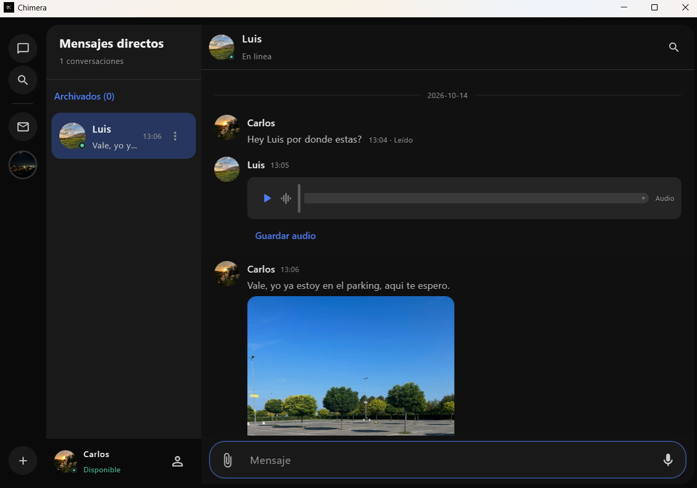
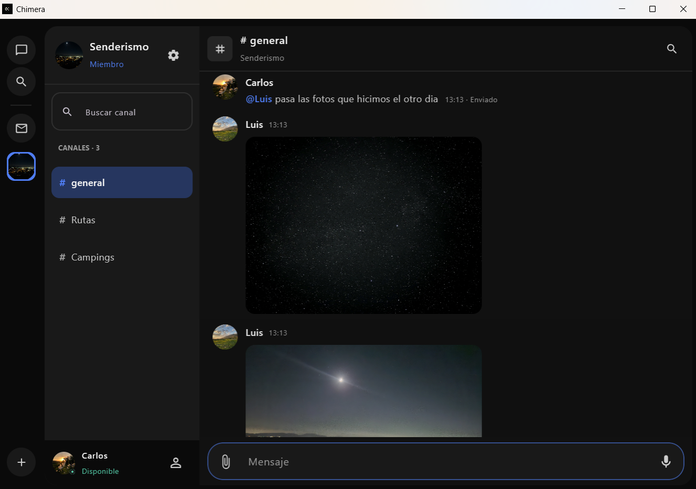
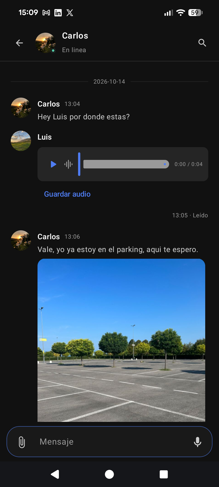
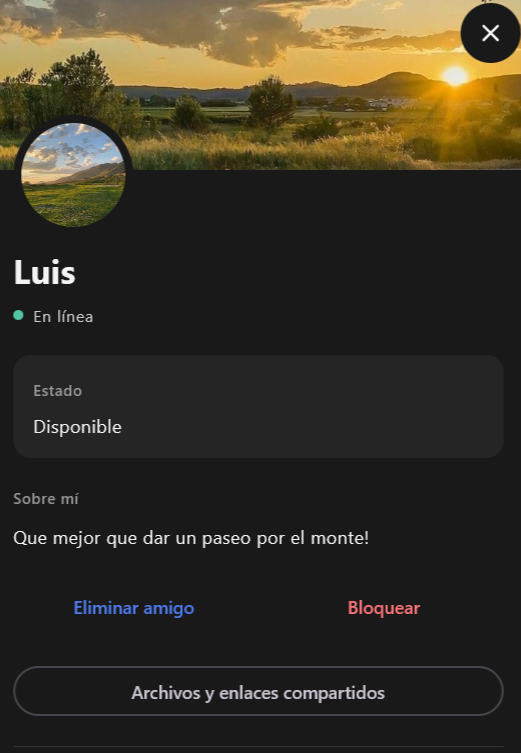

# Chimera

Aplicación de mensajería para **Android y Windows**, con conversaciones privadas,
servidores con canales, menciones y contenido multimedia. Proyecto de portfolio
construido con **Kotlin Multiplatform y Compose Multiplatform** en el cliente y
**Java / Spring Boot** en el backend.

[Backend](https://github.com/Matteodf11/chat-backend) · [Guía de demostración](docs/demo-guide.md) · [Desarrollo](docs/development.md) · [Guía rápida](docs/guia-rapida-chimera.md)

*Conversación en Windows. Las capturas muestran la aplicación real con cuentas de demostración.*

## Qué puedes hacer

- **Conversar:** mensajes en tiempo real, respuestas, edición, eliminación y búsqueda.
- **Crear comunidades:** servidores, canales, roles, invitaciones y menciones con
  autocompletado por ratón o teclado.
- **Compartir:** fotos, documentos, notas de voz, captura con cámara y ubicaciones.
- **Organizar tus chats:** fijar, archivar, silenciar y consultar mensajes sin leer.
- **Personalizar tu perfil:** avatar, portada, biografía, estado y color de la interfaz.
- **Continuar una conversación:** borradores por chat, historial en caché y una
  cola de envíos con reintentos para evitar mensajes duplicados.

## Servidores y canales

*Canales, menciones y fotos compartidas dentro de un servidor.*

## Android y perfiles

<table>
  <tr>
    <th>Conversación en Android</th>
    <th>Perfil de usuario</th>
  </tr>
  <tr>
    <td valign="top" align="center"></td>
    <td valign="top" align="center"></td>
  </tr>
</table>

## Tecnologías y decisiones

| Área | Implementación |
| --- | --- |
| Cliente | Kotlin Multiplatform, Compose Multiplatform, ViewModel y StateFlow |
| Comunicación | Ktor, HTTP y STOMP/WebSocket |
| Backend | Java 21, Spring Boot, Spring Security y JPA |
| Datos | PostgreSQL, migraciones Flyway y almacenamiento de archivos en Supabase |
| Entrega | Backend en Render; APK y MSI generados con Gradle y GitHub Actions |

La interfaz y la lógica de presentación se comparten entre Android y Windows.
Las integraciones de cámara, audio, archivos y ubicación se adaptan mediante
`expect/actual`. Los ViewModels reciben repositorios sustituibles para probar
la lógica sin depender del servidor ni del hardware.

El historial se consulta por HTTP y los cambios llegan por WebSocket. La caché
reduce cargas al navegar; cada envío conserva un identificador para que un
reintento no cree otro mensaje. La [guía de desarrollo](docs/development.md)
explica la organización del código, las pruebas y la configuración.

## Probar el proyecto

La versión de demostración es **1.1.5**: APK para Android y MSI para Windows.
El MSI incluye Java. Los paquetes conectan al backend desplegado y requieren
Internet; usa dos cuentas para probar el intercambio entre dispositivos.

Las ejecuciones correctas de [GitHub Actions](https://github.com/Matteodf11/chat-app/actions/workflows/client-checks.yml)
guardan los instaladores como artefactos durante 14 días. También puedes
[compilar desde el código](docs/development.md#compilar-y-ejecutar).
La [guía de demo](docs/demo-guide.md) incluye instalación y un recorrido de cinco minutos.

**Validación local:** 120 pruebas Kotlin y 6 pruebas JavaScript del cliente;
57 pruebas del backend. La [lista de comprobaciones](docs/release-checklist.md)
distingue estos resultados de las pruebas manuales con dispositivos.

## Alcance actual

Proyecto de demostración con APK de depuración y MSI sin firma digital.
La recuperación de contraseña por correo está pendiente; no se ofrece cifrado
de extremo a extremo ni push garantizado con la app terminada. En Windows los
avisos de mensajes permanecen dentro de Chimera. La selección de ubicación en
PC utiliza un mapa en el navegador y se confirma desde la aplicación.

Consulta los [límites de la demo](docs/demo-guide.md#límites-que-se-deben-explicar)
y la documentación de [fiabilidad de mensajes](docs/chat-reliability.md),
[servidores](docs/server-interface.md) y [ubicación](docs/location-sharing.md).

Las precauciones de la demo y el tratamiento de posibles vulnerabilidades están
en [SECURITY.md](SECURITY.md).
