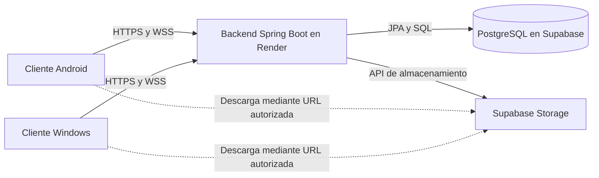
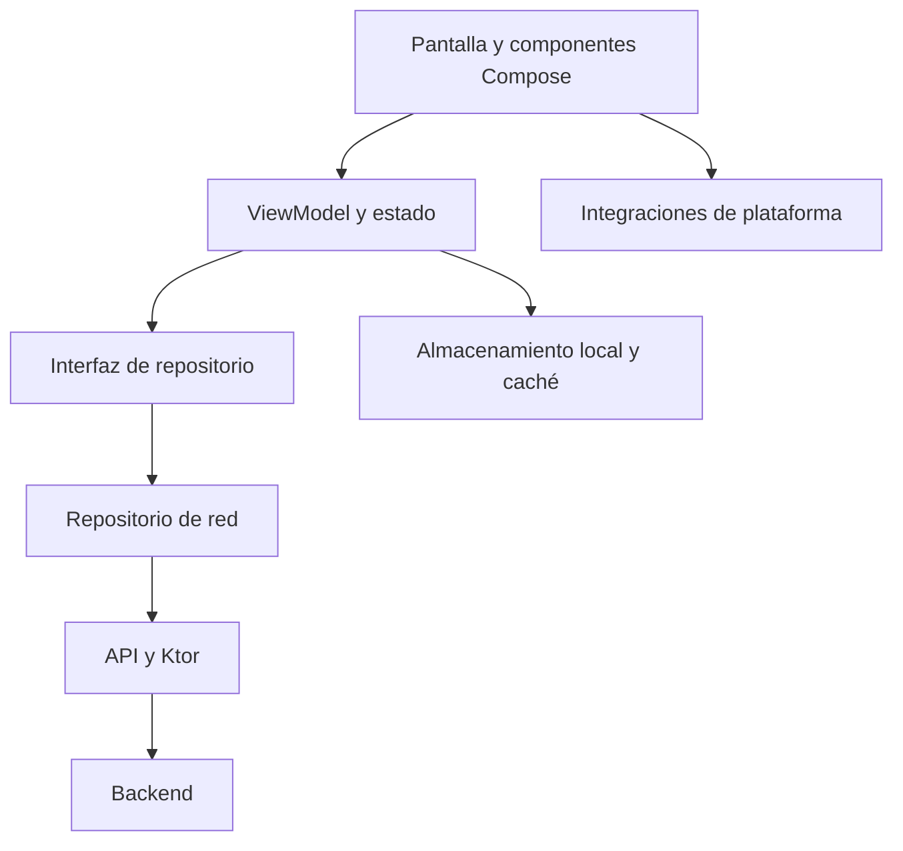
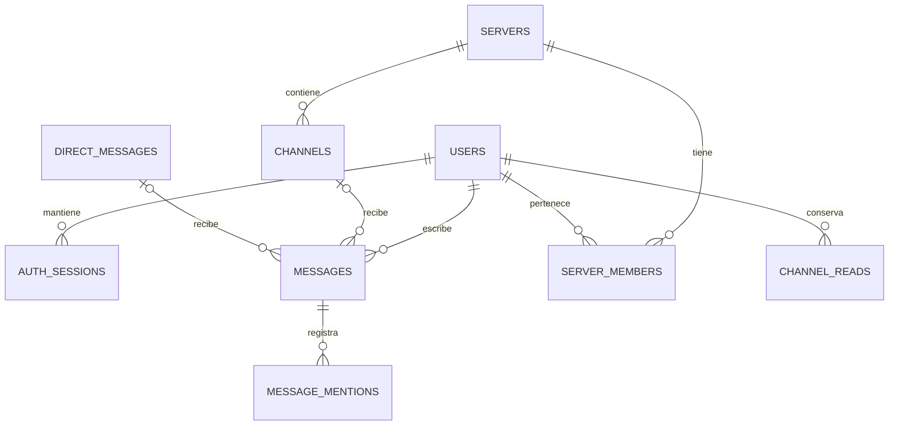
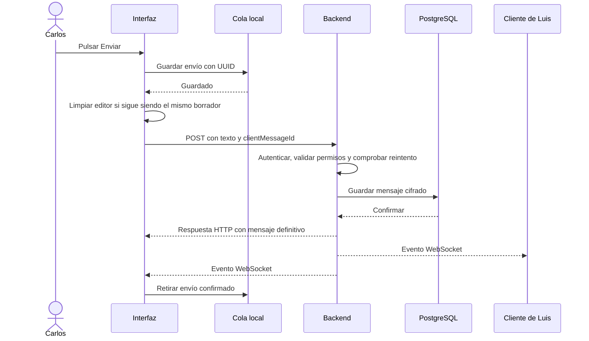
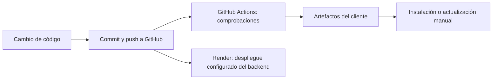

# Chimera, explicada de principio a fin

**Guía de estudio del proyecto · Estado del código: 14 de octubre de 2026 · Cliente 1.1.5**

Si primero quieres ubicar las piezas principales, empieza por la [guía rápida de componentes](guia-rapida-chimera.md), de unos 5–10 minutos de lectura.

Esta guía explica la aplicación que hemos construido: qué ve el usuario, qué ocurre por dentro, dónde se guarda cada dato, cómo se comunican sus partes y qué decisiones hacen que funcione así. Está pensada para que puedas relacionar el código con lo que has probado en Android y Windows y defender el proyecto en una entrevista.

Las explicaciones describen la implementación actual. Cuando se explica una ventaja de una decisión, se trata de su justificación técnica; no implica que todas las decisiones surgieran de un estudio previo o que sean la única solución posible. Los límites también forman parte del funcionamiento: conocerlos te permite explicar el proyecto con precisión y decidir cómo mejorarlo.

No necesitas memorizar cada clase. Lo importante es poder seguir un dato desde que el usuario lo introduce hasta que se guarda y llega a otra persona. Después puedes usar el mapa del código para encontrar la implementación concreta.

## Cómo leer esta guía

En una primera lectura, recorre los capítulos 1 a 12 para entender la estructura y el recorrido de un mensaje. En una segunda, estudia los capítulos de multimedia, seguridad y despliegue. Al final hay recorridos completos, un mapa del código y preguntas para comprobar lo que has entendido.

El [README](../README.md) presenta el producto; esta guía enseña su funcionamiento. La [documentación de desarrollo](development.md) contiene instrucciones operativas y la [guía de demostración](demo-guide.md) ayuda a enseñarlo.

## Índice

1. [Qué es Chimera y qué hemos construido](#1-qué-es-chimera-y-qué-hemos-construido)
2. [Las piezas del sistema](#2-las-piezas-del-sistema)
3. [Tecnologías y por qué encajan](#3-tecnologías-y-por-qué-encajan)
4. [Organización del cliente](#4-organización-del-cliente)
5. [Cómo funciona la interfaz](#5-cómo-funciona-la-interfaz)
6. [Organización del backend](#6-organización-del-backend)
7. [Base de datos y almacenamiento](#7-base-de-datos-y-almacenamiento)
8. [Registro, inicio de sesión y sesión recordada](#8-registro-inicio-de-sesión-y-sesión-recordada)
9. [HTTP, WebSocket y tiempo real](#9-http-websocket-y-tiempo-real)
10. [Qué sucede al enviar un mensaje](#10-qué-sucede-al-enviar-un-mensaje)
11. [Cola de envíos, borradores y reintentos](#11-cola-de-envíos-borradores-y-reintentos)
12. [Historial, sincronización y desplazamiento](#12-historial-sincronización-y-desplazamiento)
13. [Lecturas, contadores, menciones y escritura](#13-lecturas-contadores-menciones-y-escritura)
14. [Amigos, bloqueo y conversaciones privadas](#14-amigos-bloqueo-y-conversaciones-privadas)
15. [Servidores, canales, roles e invitaciones](#15-servidores-canales-roles-e-invitaciones)
16. [Perfiles y personalización](#16-perfiles-y-personalización)
17. [Archivos, imágenes, cámara y visor](#17-archivos-imágenes-cámara-y-visor)
18. [Notas de voz](#18-notas-de-voz)
19. [Ubicación en Android y Windows](#19-ubicación-en-android-y-windows)
20. [Caché, memoria y fluidez](#20-caché-memoria-y-fluidez)
21. [Notificaciones y comportamiento de escritorio](#21-notificaciones-y-comportamiento-de-escritorio)
22. [Seguridad y privacidad reales](#22-seguridad-y-privacidad-reales)
23. [Errores, límites y concurrencia](#23-errores-límites-y-concurrencia)
24. [Compilar, distribuir y desplegar](#24-compilar-distribuir-y-desplegar)
25. [Pruebas y comprobaciones](#25-pruebas-y-comprobaciones)
26. [Qué falta y cómo podría evolucionar](#26-qué-falta-y-cómo-podría-evolucionar)
27. [Recorridos completos con ejemplos](#27-recorridos-completos-con-ejemplos)
28. [Mapa del código y contratos principales](#28-mapa-del-código-y-contratos-principales)
29. [Cómo explicarlo en una entrevista](#29-cómo-explicarlo-en-una-entrevista)
30. [Glosario y comprobación de conocimientos](#30-glosario-y-comprobación-de-conocimientos)

## 1. Qué es Chimera y qué hemos construido

Chimera es una aplicación de mensajería con dos tipos de conversación: mensajes privados entre dos usuarios y mensajes en canales de un servidor. Un servidor es una comunidad con miembros y permisos; un canal es una conversación dentro de ella. No hay un proceso de backend distinto por cada comunidad: todos esos servidores son registros gestionados por el mismo backend.

El usuario puede registrarse, mantener la sesión, gestionar su perfil, relacionarse con otros usuarios, enviar texto y adjuntos, responder, editar, borrar, buscar y reenviar mensajes. También puede compartir fotos, notas de voz y ubicaciones, organizar chats y consultar actividad pendiente y menciones.

Hay una aplicación Android y una aplicación Windows. Comparten buena parte de la interfaz y la lógica, mientras que las operaciones dependientes del dispositivo tienen implementaciones específicas. El backend es independiente de ambas: valida solicitudes, aplica permisos, guarda información y distribuye eventos.

El proyecto sirve como portfolio porque conecta varios problemas reales: interfaz adaptable, autenticación, permisos, persistencia, comunicación en tiempo real, archivos, concurrencia, recuperación de errores y distribución. Es más que una colección de pantallas, aunque no ofrece todas las garantías de una plataforma de mensajería con una infraestructura grande.

## 2. Las piezas del sistema

Piensa en cuatro piezas principales:

| Pieza | Responsabilidad | Ejemplo |
| --- | --- | --- |
| Cliente Android o Windows | Mostrar la interfaz, recoger acciones y mantener estado local | Escribir un mensaje, mostrar el historial o abrir la cámara |
| Backend Java en Render | Aplicar reglas y atender peticiones | Comprobar si puedes escribir en un canal |
| PostgreSQL en Supabase | Conservar datos estructurados | Usuarios, mensajes, miembros y lecturas |
| Storage de Supabase | Conservar archivos binarios | Fotos, documentos, avatares y notas de voz |



La base de datos conserva relaciones y metadatos; Storage conserva los bytes de los archivos. Un mensaje con foto contiene una referencia al archivo, su nombre, tipo y tamaño. No metemos todos los bytes de cada foto en una columna del mensaje.

Render y Supabase no cumplen el mismo papel. Render ejecuta nuestro código del backend. Supabase nos proporciona PostgreSQL y almacenamiento. La autenticación de Chimera la implementa nuestro backend: no estamos usando Supabase Auth para iniciar sesión.

GitHub tampoco ejecuta las conversaciones ni guarda la base de datos de producción. Guarda el código, la documentación y los flujos de integración continua. Subir un commit cambia el código disponible; desplegarlo o instalar un nuevo paquete hace que ese cambio llegue al sistema que se ejecuta.

## 3. Tecnologías y por qué encajan

### Cliente

**Kotlin** es el lenguaje del cliente. Sus tipos, clases de datos, funciones suspendidas y soporte de corrutinas ayudan a expresar modelos y operaciones asíncronas con menos código repetitivo. Poder escribir menos no elimina la necesidad de gestionar errores o estados de carrera.

**Kotlin Multiplatform** organiza código compartido y código por plataforma. Permite reutilizar los modelos, repositorios, lógica de sesión, buena parte de los ViewModels y la interfaz. No convierte automáticamente una aplicación Android en una aplicación para cualquier sistema: hay que configurar cada destino y resolver sus integraciones.

**Compose Multiplatform** construye la interfaz de forma declarativa. Describimos qué mostrar para un estado determinado, y Compose actualiza la parte correspondiente cuando cambia ese estado. Usamos **Material 3** como base de componentes y una paleta propia para dar coherencia visual.

**Ktor Client** hace las peticiones HTTP y las conexiones WebSocket. **kotlinx.serialization** convierte modelos Kotlin a JSON y viceversa. **Coroutines** y **Flow** coordinan trabajos asíncronos y cambios de estado. El cliente usa OkHttp como motor de red en Android y el motor Java en escritorio.

### Backend

**Java 21** es el lenguaje y entorno del backend. **Spring Boot** configura e inicia la aplicación y reúne las piezas de Spring. **Spring Web MVC** recibe las peticiones HTTP; **Spring Security** autentica y protege rutas; **Spring WebSocket** gestiona las conexiones en tiempo real.

**Spring Data JPA** y su implementación de persistencia traducen operaciones sobre entidades a consultas de base de datos. Esto reduce código repetitivo, pero sigue siendo necesario entender SQL, índices, transacciones y consultas costosas. **PostgreSQL** conserva los datos y aplica restricciones. **Flyway** versiona los cambios del esquema.

**JJWT** crea y comprueba los JWT. **BCrypt** transforma contraseñas en hashes resistentes a intentos de adivinación. **Lombok** genera parte del código repetitivo de Java durante la compilación; no es un servicio externo ni un motor que se ejecute aparte.

### Herramientas de construcción

**Gradle** construye el cliente y **Maven** el backend. Sus wrappers permiten usar la versión prevista por el proyecto. **Docker** empaqueta el backend con su entorno de ejecución. **GitHub Actions** compila y prueba cambios automáticamente.

Las versiones principales de este estado del proyecto son:

| Componente | Versión configurada |
| --- | --- |
| Kotlin | 2.4.0 |
| Compose Multiplatform | 1.11.1 |
| Material 3 Multiplatform | 1.11.0-alpha07 |
| Coroutines | 1.11.0 |
| Ktor | 3.1.3 |
| kotlinx.serialization | 1.8.1 |
| Android Gradle Plugin | 9.0.1 |
| Java del backend | 21 |
| Spring Boot | 4.1.0 |
| JJWT | 0.12.6 |

El catálogo [libs.versions.toml](../gradle/libs.versions.toml) y el [pom.xml del backend](https://github.com/Matteodf11/chat-backend/blob/master/pom.xml) son la referencia cuando estas versiones cambien. Algunas dependencias son versiones preliminares; que la aplicación funcione no convierte esas versiones en estables.

Android tiene `minSdk 24`, `compileSdk 36` y `targetSdk 36`. El primero limita los Android más antiguos compatibles; el segundo indica contra qué SDK compilamos; el tercero declara el nivel de comportamiento de Android al que nos adaptamos. No significan que solo se ejecute en Android 36.

## 4. Organización del cliente

### Módulos y conjuntos de fuentes

| Directorio | Qué contiene |
| --- | --- |
| `shared/src/commonMain` | Interfaz compartida, modelos, APIs, repositorios y lógica común |
| `shared/src/androidMain` | Adaptaciones Android: permisos, selección de archivos, audio y almacenamiento local |
| `shared/src/jvmMain` | Adaptaciones de escritorio: webcam, mapa, archivos, audio y preferencias |
| `shared/src/javaMain` | Código basado en APIs Java reutilizado por Android y JVM, como el almacenamiento de la cola |
| `androidApp` | Aplicación Android, actividad de entrada y configuración del paquete |
| `desktopApp` | Ventana de escritorio, bandeja del sistema y distribución Windows |
| `shared/src/commonTest`, `jvmTest` y `androidHostTest` | Pruebas de lógica e integraciones comprobables sin ejecutar toda la app en un dispositivo |

`javaMain` es una organización específica de este proyecto, conectada a los destinos correspondientes; no significa que todos los proyectos KMP tengan que estructurarse así.

### Capas dentro del cliente

Una pantalla no debería decidir por su cuenta cómo firmar una petición o escribir un manifiesto en disco. Dividimos responsabilidades:



El **ViewModel** coordina una funcionalidad: qué se carga, qué está pendiente, qué hacer ante un error y qué estado mostrar. Un **repositorio** ofrece operaciones de datos, por ejemplo enviar o cargar mensajes, sin que quien lo llama tenga que construir la URL. Una **API** concreta traduce esas operaciones a peticiones de red.

La interfaz del repositorio permite sustituir una implementación real por una falsa en pruebas. Así podemos comprobar cómo reacciona el ViewModel ante una respuesta lenta o un fallo sin depender de Render ni de una cuenta real.

`AppContainer` construye estas dependencias y las entrega a las piezas que las necesitan. Es inyección de dependencias manual: no usamos un contenedor como Hilt para hacerlo. La ventaja es ver claramente qué necesita cada objeto; la contrapartida es mantener esa construcción nosotros.

El cliente HTTP principal se comparte. Las fuentes de eventos crean sus clientes de conexión WebSocket, de modo que la aplicación puede mantener varias conexiones para distintas responsabilidades. No debemos dibujar mentalmente una única conexión universal que transporta todo.

### Código común y código específico

Kotlin permite declarar un contrato común con `expect` y resolverlo por plataforma con `actual`. Por ejemplo, la lógica común puede pedir una selección de archivo sin saber si se abrirá un selector Android o un diálogo de escritorio.

Compartimos la intención de la operación, pero respetamos las APIs disponibles. Una cámara Android y una webcam Windows no se abren ni se cierran igual. Esta separación también permite probar parte de la lógica sin disponer de ese hardware.

### Algunas construcciones que verás al leer Kotlin

Una `data class` agrupa datos y genera operaciones útiles para compararlos o crear copias. Un tipo con `?`, como `String?`, permite ausencia de valor; obliga a contemplarla, aunque usar una aserción insegura todavía podría provocar un fallo. `val` impide reasignar una referencia, pero no vuelve automáticamente inmutable todo el objeto al que apunta.

Los estados cerrados de una funcionalidad pueden expresarse con clases selladas o enumeraciones: conversación privada o canal, enviando o fallido. Así se modelan las alternativas previstas y se puede exigir que un `when` las contemple.

Una lambda es una función que se entrega a otra pieza. Cuando un botón recibe `onClick`, la pantalla está entregando qué hacer al pulsarlo. El callback no tiene por qué guardar directamente en la base de datos: suele iniciar una acción del ViewModel.

La siguiente secuencia es un **esquema conceptual**, no código para copiar en un archivo:

```text
Botón -> viewModel.enviar(texto)
ViewModel -> guardar intención local -> repositorio.enviar(datos)
Repositorio -> API -> petición HTTP
Respuesta o evento -> actualizar estado -> Compose vuelve a representarlo
```

Este recorrido mantiene la interfaz dependiente del estado y evita repartir reglas de red entre todos los botones.

## 5. Cómo funciona la interfaz

### Estado y recomposición

Imagina que el estado de una pantalla contiene una lista de mensajes y un error opcional. La función Compose dibuja esa lista y, si existe, muestra el error. Cuando el ViewModel actualiza la lista, Compose vuelve a ejecutar las partes que observan ese estado. Eso se llama **recomposición**.

Recomponer no significa descargar otra vez toda la conversación ni reconstruir el proceso entero. Sin embargo, poner una petición directamente en el cuerpo de una función composable sí podría lanzarla demasiadas veces. Por eso los trabajos que dependen del ciclo de vida o de una clave se coordinan mediante efectos y corrutinas.

`StateFlow` conserva el último estado para sus observadores. `SharedFlow` se utiliza para eventos transitorios según su configuración. Una orden emitida por un flujo no equivale a un registro durable en disco: para sobrevivir a un cierre hacen falta mecanismos de persistencia.

`remember` conserva un valor mientras exista su posición en la composición. `rememberSaveable` permite restaurar determinados valores guardables dentro del ciclo de vida previsto. Ninguno sustituye por sí solo a guardar una sesión, un borrador o un envío pendiente en almacenamiento local.

### Corrutinas y respuesta de la pantalla

Una función `suspend` puede esperar sin bloquear el hilo que debe dibujar la interfaz, pero la palabra `suspend` no convierte cualquier operación pesada en trabajo de fondo. Leer un archivo con una API bloqueante, abrir hardware o decodificar imágenes requiere elegir el contexto adecuado. Por eso se usan contextos de entrada/salida y mecanismos de cancelación en las integraciones.

Si cambiamos de conversación, se cancelan trabajos ligados a la anterior y se comprueba el destino de las respuestas tardías. Sin esas comprobaciones, una petición que termina después podría colocar los mensajes de Luis en el chat de otra persona.

### Diseño adaptable y personalización

La navegación y los paneles se adaptan al espacio disponible. En escritorio caben navegación, lista y conversación simultáneamente; en móvil se reparten en vistas que se abren y cierran. Se conserva el mismo modelo de conversación, aunque cambie su presentación.

La paleta usa fondos neutros y un acento elegible: coral, azul, verde, violeta o rosa. También hay modos claro y oscuro. Un fondo muy teñido de un color fijo competía con los acentos; separar superficies y acento permite que bordes, selección y contadores tengan coherencia con cualquiera de las opciones.

Las transiciones breves dan continuidad visual sin retrasar deliberadamente la operación. Se usan las APIs de animación de Compose; no ha sido necesario introducir una librería externa solo para esos movimientos. Una animación puede hacer agradable un cambio, pero no reduce la latencia del servidor.

Los menús de acciones y adjuntos usan paneles amplios, con iconos y opciones separadas, especialmente útiles con el dedo. La tarjeta de una persona abre el chat y su nombre en la conversación abre el perfil. Es una decisión de navegación: la acción más habitual necesita menos pasos.

Los avisos de sincronización y reconexión normales trabajan en segundo plano para evitar parpadeos visuales. Los fallos que necesitan una acción del usuario siguen teniendo representación. Ocultar un aviso de actividad no elimina la actividad ni arregla por sí solo su rendimiento.

## 6. Organización del backend

El backend tiene capas con responsabilidades distintas:

| Capa | Trabajo | Ejemplo |
| --- | --- | --- |
| Controller | Recibir una ruta HTTP, extraer parámetros y devolver una respuesta | `POST /api/messages/dm/{dmId}` |
| DTO | Definir la forma de lo que entra o sale por la API | Texto, identificador de reintento y datos de un mensaje |
| Service | Aplicar reglas y coordinar operaciones | Verificar participantes, cifrar y guardar un mensaje |
| Repository | Consultar y modificar entidades persistentes | Buscar un mensaje por emisor e identificador del cliente |
| Entity | Representar datos y relaciones de la base de datos | Usuario, conversación o mensaje |
| Security y configuración | Autenticar, autorizar y configurar infraestructura | Filtro JWT y validación de suscripciones |

Una entidad puede contener información que nunca debería enviarse al cliente, como el hash de una contraseña. Por eso los DTO de respuesta se construyen con los campos necesarios. Separar DTO y entidad también permite cambiar la representación de red sin exponer directamente el esquema interno.

Spring crea y conecta muchos de estos objetos mediante inyección de dependencias. Los servicios son el lugar central para reglas de negocio, de forma que una validación no dependa solo de que una pantalla haya ocultado un botón.

Las transacciones agrupan cambios de base de datos que deben confirmarse juntos. Por ejemplo, crear una comunidad y su propietario no debe dejar un servidor sin miembro propietario si algo falla. Una transacción SQL no incluye automáticamente una subida a Storage ni la recepción de un evento por un teléfono: esos son sistemas distintos.

El backend es una aplicación única, organizada internamente por responsabilidades. No hemos dividido autenticación, chat y perfiles en microservicios. Para el tamaño del proyecto esto facilita desarrollar, desplegar y seguir los recorridos sin añadir comunicación entre numerosos servicios.

## 7. Base de datos y almacenamiento

### Qué tablas representan el producto

| Tabla | Qué representa |
| --- | --- |
| `users` | Cuenta, hash de contraseña, perfil, conexión y versión de credenciales |
| `auth_sessions` | Sesiones renovables y hashes de los tokens de renovación |
| `friendships` | Solicitudes y relaciones de amistad |
| `user_blocks` | Bloqueos de un usuario hacia otro |
| `direct_messages` | Conversación privada, actividad, lecturas y preferencias de cada participante |
| `servers` | Comunidades y su propietario |
| `server_members` | Pertenencia a una comunidad y rol |
| `channels` | Canales de texto de una comunidad |
| `server_invitations` | Invitaciones y su estado |
| `messages` | Mensajes, destino, contenido cifrado, respuesta y referencia a adjuntos |
| `message_mentions` | Usuarios mencionados por cada mensaje |
| `channel_reads` | Hasta dónde ha leído un usuario en un canal |

Existe una tabla histórica `app_users` en las migraciones antiguas. La autenticación actual trabaja con `users`; ver ambos nombres en la historia no significa que haya dos sistemas de cuenta activos.

Un mensaje pertenece a una conversación privada **o** a un canal. El servicio valida que haya exactamente un destino. Una respuesta enlaza con otro mensaje del mismo destino. Un identificador de usuario en una mención se relaciona con el mensaje que lo mencionó.



Es un esquema conceptual reducido: no incluye todas las columnas ni todas las relaciones. Los UUID identifican los registros sin depender de un contador visible. Que un identificador sea difícil de adivinar no concede seguridad por sí mismo: el backend comprueba permisos aunque conozcas el UUID.

### Integridad, índices y borrado

Las claves foráneas relacionan registros válidos. Las restricciones únicas evitan combinaciones duplicadas, como un reintento de mensaje ya registrado. Los índices ayudan a buscar por conversación, fecha, usuario o estado de lectura sin recorrer siempre todas las filas.

Muchas operaciones usan **borrado lógico**: se guarda `deleted_at` y las consultas excluyen ese registro. Permite conservar relaciones y evitar errores al referenciar mensajes antiguos, pero no significa que los datos hayan desaparecido físicamente del disco. Una política de eliminación definitiva necesitaría un proceso adicional.

### Por qué usamos Flyway

Cambiar una clase Java no basta para transformar una base de datos que ya tiene usuarios. Flyway ejecuta migraciones SQL versionadas y registra cuáles se han aplicado. En producción y desarrollo local la configuración valida que el esquema encaje, en lugar de confiar en que Hibernate lo modifique libremente.

Hay una migración base acumulada `B14__complete_chat_schema.sql` para bases PostgreSQL nuevas y migraciones posteriores para biografía, reintentos, preferencias, bloqueos, lecturas y protección de tablas. Las migraciones anteriores permanecen en la historia para instalaciones existentes.

Una migración aplicada tiene una suma de comprobación. Editarla después puede romper la validación de una instalación; lo normal es añadir otra migración con el cambio. Las variantes PostgreSQL y H2 permiten probar con los motores adecuados sin fingir que su SQL es idéntico.

### PostgreSQL y Storage no son intercambiables

Al guardar una foto, Storage recibe el archivo y PostgreSQL recibe su referencia. Si la subida funciona pero el guardado posterior falla, el servicio intenta limpiar el archivo. Esta compensación reduce basura, pero no ofrece una transacción distribuida perfecta entre ambos sistemas.

Las tablas de aplicación en Supabase están protegidas frente al acceso directo con los roles públicos correspondientes. La aplicación cliente habla con nuestro backend, que usa credenciales de servidor. La clave privilegiada de Storage debe permanecer allí y no formar parte del APK o del instalador.

## 8. Registro, inicio de sesión y sesión recordada

### Registrarse

La pantalla valida datos antes de enviar para dar una respuesta rápida: formato de correo, longitud del nombre y contraseña, confirmación de contraseña. El backend vuelve a validar; un atacante podría saltarse la interfaz y llamar a la API directamente.

El backend normaliza el correo, comprueba duplicados y guarda el usuario con un hash BCrypt de la contraseña. No guarda la contraseña original. El registro crea una sesión y devuelve la identidad y las credenciales necesarias para continuar.

En este estado, el cliente exige una contraseña de entre 10 y 72 caracteres y un nombre de entre 3 y 50. Los límites reales de validación están en los DTO y el ViewModel, y deben mantenerse coherentes cuando se cambien.

### Dos credenciales con trabajos diferentes

| Credencial | Para qué sirve | Dónde se conserva |
| --- | --- | --- |
| JWT de acceso | Autenticar peticiones durante un periodo corto | Memoria del cliente |
| Token de renovación | Pedir un nuevo acceso sin escribir la contraseña otra vez | Almacenamiento local si se recuerda la sesión; hash en el backend |

El JWT dura **15 minutos**. Contiene el correo como sujeto y una versión de credenciales, además de fechas. Su firma permite detectar modificaciones. Su contenido es legible si decodificas el token: firmar un JWT no cifra sus datos.

El token de renovación se genera con 32 bytes aleatorios y se representa en Base64 URL. En la base de datos se guarda su hash SHA-256, junto con usuario, dispositivo, fechas y revocación. El valor original es una credencial: quien lo obtenga podría intentar usarlo mientras siga siendo válido.

Una sesión recordada tiene por defecto una ventana renovable de **90 días**, configurable. Una sesión no persistente tiene una vigencia de **un día** sin la misma prolongación. La duración del JWT y la duración de la sesión recordada son decisiones separadas: no fue necesario hacer que un JWT viviera meses para evitar pedir la contraseña continuamente.

### Abrir la aplicación otro día

Al arrancar, `App` consulta las preferencias y las credenciales guardadas. Si encuentra una sesión recordada, intenta renovarla antes de mostrar el área autenticada. Si hay un problema temporal de red, conserva la credencial y ofrece reintentar. Si el backend rechaza la renovación por credenciales inválidas, limpia la sesión y vuelve al acceso.

Cada renovación entrega un JWT y rota el token de renovación. El cliente sustituye el anterior. La rotación limita el uso continuado de una credencial antigua, pero obliga a coordinar solicitudes simultáneas.

`SessionRefresher` usa un `Mutex` para que varias peticiones dentro del mismo proceso no renueven a la vez. Si una ya obtuvo un token nuevo, las demás pueden aprovecharlo. Ese mutex no coordina dos procesos independientes de escritorio; su alcance es la instancia en ejecución.

El cliente hace además una renovación periódica aproximadamente cada diez minutos. Los fallos temporales se reintentan, mientras que un rechazo de autenticación hace salir de la sesión. El interceptor HTTP puede recuperar una petición que haya recibido un 401 y repetirla una vez con el acceso actualizado. No convierte cualquier 403 de permisos en una renovación.

### Dónde se recuerda

Android usa preferencias privadas de la aplicación. Windows usa `java.util.prefs.Preferences`. La contraseña no se persiste, y el JWT de acceso vive en memoria. Sin embargo, las preferencias usadas para el token de renovación **no son una caja fuerte cifrada mediante Android Keystore o Windows DPAPI**. Es una mejora de seguridad pendiente, especialmente frente a alguien con acceso al perfil local del sistema.

### Salir y cambiar la contraseña

Al cerrar sesión, el cliente limpia sus credenciales y solicita revocar la sesión renovable. Una interrupción de red no debe dejar al usuario atrapado en una sesión local. Un JWT ya emitido puede seguir siendo válido hasta su expiración; revocar el token de renovación no reescribe ese JWT.

Cambiar la contraseña requiere conocer la actual. El backend la comprueba, genera un nuevo hash, incrementa `tokenVersion` y revoca las sesiones de renovación. Las siguientes peticiones HTTP con una versión antigua se rechazan. El cliente vuelve a pedir acceso.

Esto no equivale a implementar recuperación por correo y tampoco garantiza cortar instantáneamente cada WebSocket ya autenticado de otro dispositivo. La recuperación sin sesión sigue pendiente y requerirá un flujo propio con un token temporal y envío de correo real.

## 9. HTTP, WebSocket y tiempo real

### Petición y respuesta: HTTP

HTTP sirve para pedir una operación y recibir su resultado: iniciar sesión, cargar un historial, actualizar un perfil o enviar un mensaje. Una petición tiene un método, una ruta, cabeceras y, cuando corresponde, un cuerpo.

Por ejemplo, un `GET` consulta datos, un `POST` crea o ejecuta una operación, un `PUT` actualiza y un `DELETE` solicita eliminar. Estas convenciones hacen la API comprensible; la autorización sigue dependiendo del servidor.

El cliente añade `Authorization: Bearer ...` para las rutas protegidas. Los objetos se intercambian normalmente en JSON. Los adjuntos usan `multipart/form-data`, que permite enviar campos y un archivo en una petición. HTTPS cifra el trayecto entre cliente y backend.

Por ejemplo, una petición de texto privado tiene esta forma. Los UUID son ilustrativos y no pertenecen a cuentas reales:

```http
POST /api/messages/dm/00000000-0000-4000-8000-000000000001
Authorization: Bearer <token de acceso>
Content-Type: application/json
```

```json
{
  "content": "Estoy en el parking",
  "dmId": "00000000-0000-4000-8000-000000000001",
  "clientMessageId": "00000000-0000-4000-8000-000000000002"
}
```

No aparece una contraseña ni un hash de contraseña en este cuerpo. El emisor se obtiene de la autenticación. `replyToId` se añade cuando es una respuesta. La respuesta del servidor tiene más información que la petición porque ya conoce el mensaje persistido, su autor, sus fechas y sus referencias.

El cliente tiene límites de espera: unos 15 segundos para establecer conexión y hasta 60 segundos en las operaciones configuradas. Un tiempo de espera evita esperar indefinidamente, pero no demuestra que el servidor no haya completado la operación. Esa ambigüedad es una de las razones para tener reintentos idempotentes.

### Eventos sin preguntar continuamente: WebSocket

WebSocket mantiene una conexión abierta para que el backend pueda enviar eventos cuando ocurren. Así el receptor no tiene que consultar cada segundo si alguien ha escrito. WSS es su variante protegida por TLS.

Sobre esa conexión usamos **STOMP**, un protocolo de mensajes con operaciones como conectar, suscribirse y enviar. En el cliente se construyen y procesan sus tramas de texto. El endpoint nativo es `/ws-native`; existe además un endpoint con SockJS como compatibilidad, pero no es el recorrido principal de nuestros clientes.

En la conexión se comprueba el JWT y se asocia el usuario autenticado. La implementación también transporta el token en la URL de conexión, además de la cabecera STOMP. Por eso hay que cuidar los registros de URLs: sanear la cabecera HTTP no garantiza ocultar automáticamente cualquier token en un parámetro.

### Destinos y suscripciones

Un destino es una dirección lógica dentro del sistema de eventos. Suscribirse significa pedir que los eventos de ese destino lleguen por la conexión.

| Destino | Utilidad |
| --- | --- |
| `/topic/channel.{id}` | Cambios de mensajes del canal activo |
| `/topic/dm.{id}` | Cambios de mensajes de una conversación privada |
| `/topic/typing...` | Estado de escritura de una conversación |
| `/user/queue/messages` | Eventos privados de mensajes del usuario |
| `/user/queue/read-receipts` | Confirmaciones de lectura |
| `/user/queue/dm-settings` | Preferencias de conversaciones |
| `/user/queue/contacts` y `/user/queue/friends` | Cambios en contactos y amistad |
| `/user/queue/server-events` | Invitaciones y cambios de comunidades |
| `/topic/presence` y `/topic/profile` | Cambios de conexión y perfil para clientes autenticados |

El servidor comprueba que una suscripción a un canal o conversación corresponda a alguien con acceso. Los temas globales de perfil y presencia están disponibles para usuarios autenticados; no hay que describirlos como un canal privado exclusivo para amigos.

### Enviar por HTTP y recibir por WebSocket

El recorrido principal actual envía los mensajes mediante HTTP. Después de guardarlos, el backend publica eventos WebSocket para actualizar las pantallas. Existe código compatible con un envío STOMP, pero eso no significa que cada pulsación de «Enviar» de la interfaz utilice esa vía.

Esta combinación da una respuesta directa para la operación de envío y una vía de difusión para los demás usuarios. También puede hacer que el emisor vea el mismo mensaje por la respuesta HTTP y por un evento. El cliente tiene que reconocer que se trata del mismo registro.

### Conexiones que se interrumpen

Hay latidos periódicos para detectar conexiones que han dejado de responder. Las fuentes de eventos reintentan y vuelven a suscribirse. En la conversación activa la espera crece desde aproximadamente 1,5 segundos hasta un máximo de 15, evitando un bucle de reconexión continuo.

Una conexión nueva no trae mágicamente los eventos perdidos durante el corte. El cliente vuelve a consultar datos por HTTP y los combina con lo que conserva. Por eso tiempo real y sincronización del historial son mecanismos complementarios.

El backend utiliza el broker simple de Spring, que vive en memoria del proceso. No usamos Kafka, RabbitMQ ni un registro persistente de todos los eventos. Si el backend se reinicia, las conexiones se rehacen y PostgreSQL sigue siendo la referencia de los mensajes guardados.

## 10. Qué sucede al enviar un mensaje

Este es el recorrido más importante para entender la aplicación. Imagina que Carlos escribe «Estoy en el parking» a Luis.

### Primero, el cliente protege la intención del usuario

1. La interfaz recoge el texto, la conversación y, si existe, una respuesta o un adjunto.
2. El ViewModel valida que haya algo enviable y genera un `clientMessageId`, un UUID para ese envío.
3. Se escribe una entrada durable en la cola local antes de dar por aceptado el envío en el editor.
4. Cuando esa escritura funciona, se publica el estado pendiente y se solicita limpiar la caja de texto.
5. Una corrutina comienza la petición HTTP al backend.

La caja no espera a que Render y la base de datos hayan terminado para vaciarse. Tampoco se vacía antes de que exista una copia local de lo que se intentó enviar. Si el disco falla al guardar la cola, se conserva el texto para no perderlo.

### Después, el backend decide si el mensaje es válido

El backend obtiene el emisor de la identidad autenticada. No confía en un campo del cliente que diga «soy Carlos». Comprueba que haya un único destino, que el usuario pertenezca a él, que la conversación no esté bloqueada cuando corresponde y que el contenido respete los límites.

Si hay una respuesta, el mensaje al que se responde debe existir y pertenecer a la misma conversación. Si hay menciones en un canal, se resuelven contra sus miembros. Si hay archivo, se valida y se coordina la subida a Storage.

Antes de crear otro mensaje, se busca la combinación de emisor y `clientMessageId`. Si ya se guardó, se devuelve el registro existente siempre que corresponda al mismo destino y siga siendo válido. Hay además una restricción única en base de datos y bloqueo de la fila del emisor para coordinar intentos concurrentes.

El texto se cifra, se crea el registro con sus metadatos y se confirma la operación. El cliente recibe un DTO con el identificador definitivo del servidor, fechas y datos de presentación.

### Finalmente, las pantallas convergen

El backend publica el mensaje en el destino de la conversación y, para mensajes privados, en las colas personales pertinentes. El emisor sustituye su entrada pendiente por el mensaje confirmado. El receptor lo incorpora a su conversación o al resumen de su bandeja.



El diagrama muestra un orden habitual. La respuesta y el evento pueden llegar en otro orden; el código no debería depender de que HTTP siempre gane. Por eso se reconoce el envío por `clientMessageId`, emisor y destino, y se deduplican mensajes por el identificador del servidor.

### Por qué hacen falta dos identificadores

El identificador definitivo pertenece al registro del servidor. El identificador del cliente existe antes de tener red y permanece igual al reintentar.

Supón que el servidor guarda el mensaje, pero se pierde la respuesta. Sin identificador estable, pulsar «Reintentar» podría crear una copia. Conservando el mismo UUID, el backend reconoce la operación y devuelve el mismo mensaje. Esto es **idempotencia** del guardado; no significa que cada evento de red se entregue exactamente una vez.

## 11. Cola de envíos, borradores y reintentos

### Borrador y envío pendiente son cosas distintas

Un borrador es contenido que todavía estás preparando. Un envío pendiente es contenido que ya has decidido enviar y cuya entrega estamos gestionando. Mezclarlos haría difícil saber qué conservar cuando cambias de chat o cierras la aplicación.

El texto del borrador se guarda por cuenta y conversación. Los adjuntos preparados y la respuesta seleccionada tienen estado de sesión con un presupuesto de memoria. No todos esos preparativos sobreviven a terminar el proceso. Cuando se encolan, los bytes necesarios sí pasan al almacenamiento durable de envíos.

### Evitar el borrado del texto equivocado

El editor tiene una revisión de su contenido. Al enviar se captura esa revisión y el texto. La confirmación de encolado solo limpia el editor si sigue correspondiendo al mismo borrador.

Ejemplo: escribes «Hola», pulsas enviar y empiezas «¿Qué tal?» antes de que termine el guardado local. Una devolución tardía no debe borrar «¿Qué tal?». Tampoco debe limpiar la caja de otra conversación si has cambiado de chat.

Esto explica por qué arreglar «la caja no se vacía» requería coordinar el dueño del estado y el momento de limpieza, no solo añadir una asignación a una variable cualquiera.

### Cómo se guarda la cola

`FileChatLocalStore` crea un espacio separado por cuenta. El nombre de ese espacio deriva de un hash del correo para no mezclar cuentas; **no es cifrado de los archivos**.

En Windows el estado vive bajo `~/.chimera/chat-state`; en Android, dentro de `noBackupFilesDir/chat-state` de la aplicación. Cada envío tiene información JSON y, si lo necesita, un archivo binario. Se escribe primero un temporal, se sincroniza con disco y se sustituye el destino de forma atómica en el mecanismo previsto.

Eso reduce la posibilidad de que un cierre deje medio JSON como si fuera un envío completo. Al retirar un envío confirmado, se elimina primero el manifiesto para evitar que reaparezca como pendiente si la limpieza de su binario se interrumpe.

Los archivos pendientes no son simples miniaturas de caché. No se deben borrar con una limpieza genérica de imágenes temporales, porque podrían ser la única copia que conserva el envío que pidió el usuario.

### Qué ocurre si falla

El envío pasa a estado fallido con una explicación y acciones de reintentar o descartar. Reintentar conserva el UUID. Descartar retira una entrada fallida y sus recursos locales.

Después de reiniciar, los envíos restaurados se presentan como fallidos y requieren reintento; no hay un reenvío automático indiscriminado de todo lo encontrado en disco. Así el usuario mantiene control sobre operaciones que pudieron quedar en una situación ambigua.

Una cola local mejora la recuperación, pero no hace que todas las funciones de la app funcionen sin Internet. Crear servidores, descargar un archivo no disponible o consultar historial antiguo siguen necesitando el backend.

### Varias fotografías

Una selección de varias fotos se guarda como lote antes de limpiar su preparación. Cada foto tiene su propio identificador y acaba siendo un mensaje individual. El comentario y la respuesta se aplican según el comportamiento del lote, empezando por el primer envío.

No es una transacción del servidor que garantice «las diez fotos o ninguna». Algunas pueden llegar y otras fallar. Los reintentos permiten recuperar las restantes sin duplicar las confirmadas.

## 12. Historial, sincronización y desplazamiento

### No descargarlo todo al abrir

Una conversación puede crecer indefinidamente. Cargar todos sus mensajes en cada apertura consumiría red, memoria y tiempo. El backend pagina: devuelve una página reciente, normalmente 50 mensajes, con un máximo de 100 en la consulta permitida y una indicación de si queda historial anterior.

Al subir por la conversación se piden páginas anteriores. El servidor consulta registros por destino y fecha; el cliente los presenta en orden cronológico. La paginación principal usa la fecha como cursor, por lo que no conviene afirmar que resuelve todos los casos extremos de mensajes con marcas temporales idénticas mediante un cursor compuesto. La galería compartida sí utiliza fecha e identificador para su recorrido.

### Mostrar lo conocido y actualizar después

Si la conversación está en la caché de memoria, el cliente puede mostrarla al entrar y refrescarla en segundo plano. Si no está, tiene que hacer una carga inicial. La caché tiene límites; después de cerrar el proceso no queda una base local completa del historial.

Durante una sincronización pueden llegar eventos. El ViewModel los conserva y combina con la respuesta HTTP, en vez de permitir que una fotografía antigua del servidor pise un mensaje recién recibido. Se fusionan registros por identificador y se ordenan de forma consistente.

Si hubo un corte largo, se pueden pedir páginas hasta encontrar solapamiento con lo conocido. No basta con consultar siempre los últimos pocos mensajes si entre ellos y tu caché quedó un hueco.

### Por qué una imagen puede mover el chat

Una lista se mide a partir de la altura de sus elementos. Cuando una imagen termina de cargar o decodificarse, su altura puede cambiar. El teclado también modifica el espacio visible. Si la pantalla interpreta esos cambios como una orden de «ir al final», puede saltar mientras estabas leyendo.

La implementación distingue el seguimiento del final, el desplazamiento del usuario y los movimientos programáticos. Si estabas cerca del final, reajusta la posición cuando el contenido crece; si estás leyendo arriba, conserva tu intención y puede ofrecer un indicador de mensajes nuevos para volver cuando quieras.

La lista usa identidades estables para sus elementos. Las pruebas comprueban cálculos de cercanía al final y conteo de llegadas. Aun así, el comportamiento visual con imágenes muy altas, teclado y cambios de tamaño necesita comprobaciones reales en dispositivos.

### Búsqueda, contexto y contenido compartido

La búsqueda admite texto y filtros como autor, fechas o adjuntos. Al abrir un resultado se consulta su contexto: mensajes anteriores y posteriores para situarlo en la conversación. Esto evita cargar desde el primer mensaje para encontrar una coincidencia antigua.

Como el texto está cifrado, la búsqueda actual obtiene un conjunto acotado de candidatos, los descifra en el backend y filtra allí. Trabaja con hasta 1.000 candidatos recientes y devuelve hasta 50 resultados. **No es un índice de texto completo sobre todo el historial sin límites.** Es una solución funcional con un coste y un alcance que hay que conocer.

El apartado de archivos y enlaces compartidos de un chat privado recorre mensajes y clasifica su contenido. Los enlaces se extraen del texto descifrado; los archivos se reconocen por sus metadatos. Que un modelo tenga una categoría genérica para un formato no implica que la interfaz permita enviar cualquier tipo de archivo: la lista de tipos autorizados manda.

### Responder, editar, eliminar y reenviar

Responder guarda una referencia al mensaje original y muestra un resumen. El backend impide responder a un mensaje de otro destino. Editar o eliminar exige ser el autor y conservar el acceso correspondiente.

Editar actualiza el contenido y las menciones cuando procede. Eliminar realiza un borrado lógico y publica un cambio para que las pantallas retiren el mensaje; se intenta limpiar el adjunto. No es una garantía de borrado físico de todos los datos y copias.

Reenviar crea un mensaje nuevo en otro destino. Se comprueba el acceso al original; para un adjunto se obtienen los bytes y se realiza el nuevo envío. No concedemos permiso a un destino simplemente copiando una clave interna de Storage, y no se conserva una respuesta que apunte a otra conversación.

## 13. Lecturas, contadores, menciones y escritura

### Qué significa «leído»

El sistema conserva hasta qué fecha de mensaje ha avanzado la lectura de cada participante o miembro. Ese punto se suele llamar **marca de lectura**. Un mensaje posterior, de otra persona y no eliminado, puede contar como pendiente.

En una conversación privada, se actualiza la marca según la conversación abierta, el primer plano de la aplicación y el último mensaje cargado que gestiona el ViewModel. Es una aproximación al comportamiento de lectura: no demuestra que los ojos hayan recorrido cada línea de una foto alta.

En canales se comprueba además que la conversación ya esté posicionada, que la lista no esté desplazándose y que esté cerca del final antes de marcar el último mensaje. Hay pequeñas esperas para evitar actualizar continuamente mientras se mueve la pantalla.

El backend verifica que el mensaje marcado pertenezca al destino y solo permite avanzar la marca, no retrocederla con una petición tardía. Usa coordinación transaccional para que dos actualizaciones no dejen una lectura más antigua.

Cuando Luis lee un mensaje privado de Carlos, el backend emite una confirmación. Carlos puede mostrar «Leído» si la marca de Luis alcanza la fecha de ese mensaje. «Enviado» significa que el servidor lo aceptó, no que Luis lo haya visto ni que exista un acuse separado de cada dispositivo.

### Contadores fiables

Los pendientes se calculan a partir de datos persistidos, no solo incrementando una variable cuando llega un evento. Eso permite reconstruirlos al abrir en otro dispositivo o después de un reinicio.

En los canales se excluyen mensajes propios, eliminados, anteriores a la entrada del usuario o ya cubiertos por su lectura. La actividad se consulta por los canales accesibles y se agrega para mostrar también indicadores en el servidor.

El cliente usa eventos para refrescar con rapidez, agrupa ráfagas cercanas y tiene una consulta periódica, aproximadamente cada 30 segundos, como respaldo. Sigue habiendo pequeños intervalos de consistencia eventual: un contador puede actualizarse un momento después del mensaje.

### Mencionar no es solo colorear texto

La interfaz detecta que estás escribiendo `@`, filtra candidatos y permite elegir por ratón o con teclado. Las flechas cambian la selección y Tab completa. Al insertar el nombre se controla el foco y la posición del cursor.

El backend interpreta las menciones válidas contra los miembros del servidor y guarda sus identificadores en `message_mentions`. Eso permite contar menciones para un usuario sin descifrar todos los mensajes cada vez. Se tienen en cuenta nombres Unicode y nombres con espacios; se priorizan coincidencias largas y se evitan duplicados por usuario.

Un mensaje con dos referencias a Luis sigue siendo un mensaje que menciona a Luis, no dos mensajes pendientes. El backend acota a 20 destinatarios de mención por mensaje y excluye al propio autor. Editar o borrar ajusta las menciones correspondientes.

Si ves **12 pendientes y 2 menciones**, esas 2 están incluidas dentro de los 12; no son 14 mensajes. Por eso los indicadores deben permitir ver las dos cifras en lugar de sustituir una por la otra. Se utiliza el acento del tema para mejorar su lectura.

Guardar identificadores mantiene la asociación con la persona. El texto del nombre escrito puede quedar antiguo si después cambia su nombre; no es un sistema que reescriba automáticamente todo el historial.

### «Está escribiendo»

Es un evento temporal con identidad, destino y estado. No se transmite el contenido del borrador. El cliente limita la frecuencia, detiene el aviso tras un periodo corto sin teclear y hace caducar los avisos recibidos si no se renuevan.

El servidor comprueba acceso y límites de frecuencia también aquí. El estado de escritura no se guarda como un mensaje ni tiene por qué sobrevivir a un reinicio; perder un evento se corrige por caducidad.

## 14. Amigos, bloqueo y conversaciones privadas

### Solicitudes y amistad

Una solicitud relaciona solicitante y destinatario y tiene un estado. Solo el destinatario correspondiente puede aceptar o rechazar. El backend impide solicitudes a uno mismo y controla duplicados y situaciones incompatibles.

Aceptar permite reflejar la relación en ambas interfaces mediante eventos. La lista de amigos usa datos de perfil y presencia, mientras que la lista de conversaciones usa actividad y preferencias de chat. Son listas relacionadas, pero no son la misma entidad.

### Abrir una conversación

La conversación privada representa un par de usuarios y se busca en ambos órdenes para reutilizarla. El backend comprueba participantes y bloqueos. La implementación actual no exige una amistad aceptada como condición universal del servicio para crear una conversación; no debemos presentar esa restricción como una garantía que el backend no tiene.

Un chat conserva actividad, marcas de lectura y opciones separadas para cada participante. Que Carlos archive el chat no significa que Luis lo archive. Lo mismo ocurre con fijar o silenciar.

La ordenación coloca primero los fijados y después la actividad reciente. Se tiene en cuenta el resumen conocido del servidor y el estado local para que un envío reciente no mande la conversación al fondo mientras se refrescan datos. Se usa un desempate estable cuando dos registros tienen la misma actividad.

Archivar aparta de la lista principal; no elimina el historial. Silenciar no deja de recibir mensajes ni elimina sus contadores. Suprimir avisos externos y recibir contenido son operaciones distintas.

### Bloquear

El bloqueo es direccional en su registro, pero las comprobaciones de contacto y envío tienen en cuenta la pareja. Se impiden las nuevas interacciones privadas correspondientes y se ajusta la amistad. Desbloquear no recrea automáticamente una amistad eliminada.

No borra el historial anterior ni implica ocultar a ambas personas en cualquier servidor compartido. Una funcionalidad de moderación global tendría otras reglas.

Al modificar relaciones entre dos usuarios se bloquean las filas en un orden estable. Esto evita que una operación tome primero a Carlos y espere a Luis mientras otra tome primero a Luis y espere a Carlos, situación típica de un interbloqueo.

### Presencia real

El backend cuenta sesiones WebSocket por usuario. Cerrar una de ellas no marca desconectado al usuario si conserva otras conexiones o dispositivos. Al desaparecer la última se actualiza su estado y última conexión.

Este registro de conexiones vive en memoria del backend, por lo que debe reconstruirse después de reiniciar. El estado visible «Disponible», «Ausente», «Ocupado» o «Invisible» es además un dato de perfil; no hay que confundirlo con la existencia real de una conexión ni prometer privacidad completa solo por seleccionar «Invisible».

## 15. Servidores, canales, roles e invitaciones

Al crear un servidor, una transacción crea la comunidad, añade al creador como propietario y prepara el canal de texto general. Así no aparecen piezas iniciales incompletas si falla un paso de base de datos.

### Permisos

| Rol | Responsabilidades actuales |
| --- | --- |
| Propietario | Gestionar el servidor, roles y miembros, y eliminar la comunidad |
| Administrador | Gestionar datos, canales e invitaciones, y expulsar miembros ordinarios según las reglas |
| Miembro | Acceder y participar en los canales autorizados de su comunidad |

Solo el propietario cambia los roles de otros miembros. Un administrador no puede expulsar al propietario ni a otro administrador. El propietario no se degrada ni se expulsa mediante esas operaciones. No hay transferencia de propiedad implementada para poder marcharse conservando la comunidad: el flujo actual exige resolverlo mediante la eliminación del servidor.

La interfaz muestra las acciones adecuadas, pero el servicio vuelve a comprobar los permisos. Hacer visible un botón mediante una modificación del cliente no debe dar más autoridad.

### Invitaciones y pertenencia

Se invita a una cuenta por el identificador admitido por el flujo, como nombre o correo. La invitación queda pendiente y el destinatario la acepta o rechaza. Al aceptar se crea o reactiva su pertenencia y llegan los eventos necesarios para actualizar la navegación.

Esto es distinto de un enlace público de invitación con un código reutilizable; no hemos implementado ese producto completo.

Los canales actuales son de texto. No existen llamadas de voz o vídeo ni canales de voz por el hecho de que el diseño recuerde a aplicaciones que sí los tienen.

### Salir, expulsar y eliminar

El backend cambia la pertenencia o realiza borrados lógicos según la operación. El cliente recibe cambios de acceso, retira la selección que ya no corresponde y actualiza listas y actividad.

Las siguientes peticiones HTTP comprueban de nuevo la pertenencia. La autorización WebSocket se realiza al conectar y suscribirse; no debe venderse como una garantía de que toda suscripción previamente abierta se revalida instantáneamente tras cualquier cambio de permisos. Endurecer esa revocación es una mejora posible.

## 16. Perfiles y personalización

El perfil incluye nombre, avatar, portada, biografía, estado y fechas relevantes. El panel de otra persona agrupa su identidad y acciones, en lugar de tratarlo como una ventana casi vacía. La sección de contenido compartido da acceso al material del chat correspondiente.

El perfil propio permite modificar esos campos y acceder a opciones de cuenta, seguridad y personalización. La biografía tiene un máximo de 300 caracteres. Los cambios de perfil se distribuyen con eventos para evitar que un nombre o avatar quede antiguo en las pantallas ya abiertas.

### Perfil remoto y tema local

No todos los ajustes viven en el mismo sitio. Nombre, biografía, estado y fotos se guardan en el backend. El modo claro u oscuro y el acento de la interfaz usan preferencias locales.

Existe un campo `profile_color` en el modelo del servidor, pero el flujo actual de guardar perfil no equivale a sincronizar automáticamente el tema local entre todos tus dispositivos. No conviene explicar «cambio el azul en Android y aparece en Windows» como una propiedad garantizada del diseño actual.

### Fotos de perfil y resolución

El backend admite archivos de perfil de hasta 2 MiB en los formatos previstos, como JPEG, PNG y WebP. Almacena el original aceptado; no lo reduce siempre a una imagen minúscula fija.

El componente del cliente elige una resolución de decodificación apropiada al tamaño y densidad de la pantalla. Decodificar siempre una miniatura pequeña y después ampliarla producía pixelado, especialmente visible en escritorio. También consulta la caché antes de mostrar una inicial para evitar ese parpadeo cuando la imagen ya está disponible.

Cuando cambia una foto se usan referencias versionadas para que el cliente no reutilice indefinidamente la anterior. Los endpoints de lectura de estas imágenes de perfil son accesibles sin autenticación: no deben considerarse fotografías privadas protegidas igual que un adjunto de conversación.

### Guardados y fallos parciales

Actualizar texto del perfil, subir avatar y subir portada son operaciones separadas. Si una falla después de otra, puede haberse guardado una parte. La pantalla debe informar de lo ocurrido; no hay una única transacción que incluya todas las llamadas y Storage.

El selector de imagen de escritorio se abre fuera del contexto que dibuja Compose, controla errores y cierra sus recursos. La excepción que apareció al cambiar avatar recordaba precisamente que los diálogos nativos bloqueantes y la interfaz declarativa necesitan una integración cuidadosa.

## 17. Archivos, imágenes, cámara y visor

### Elegir el origen adecuado

El menú de adjuntos distingue fotografía, cámara, archivo y ubicación. Es una separación de intenciones: para enviar una foto es más natural abrir una galería que obligar siempre a recorrer el explorador de documentos.

Android utiliza los selectores y contratos de actividad del sistema, obtiene acceso al contenido y lee sus bytes. Windows utiliza diálogos de archivos y sus integraciones disponibles. El resultado común incluye nombre, tipo y contenido binario para que la lógica de envío no dependa de cómo se eligió.

Leer un archivo exige comprobar tamaño y errores antes de cargarlo entero. También se protege la lectura frente a archivos que crezcan o entreguen más bytes de los esperados. Cancelar el selector es un resultado normal, no un fallo fatal de la aplicación.

### Límites y validación

| Contenido | Límite relevante en el flujo actual |
| --- | --- |
| Texto de mensaje | 4.000 caracteres |
| Adjunto de chat | 25 MiB por archivo |
| Petición multipart del backend | 26 MB configurados para admitir archivo y campos |
| Selección de fotos | Hasta 10 fotos y 50 MiB en total |
| Adjuntos preparados en borradores de sesión | Presupuesto total de 100 MiB |
| Avatar, portada o icono de servidor | 2 MiB |
| Biografía | 300 caracteres |

MiB es una unidad binaria: 1 MiB son 1.048.576 bytes. El límite de petición incluye más que el archivo, de ahí que no sea exactamente el mismo número.

El servidor aplica una lista permitida de tipos y comprueba firmas de varios formatos habituales. El nombre y el MIME aportados por el cliente no son pruebas suficientes de que un archivo sea lo que dice.

Estas comprobaciones no constituyen un antivirus ni un análisis completo de cada documento. Tampoco conviene ampliar indiscriminadamente los tipos aceptados sin revisar cómo se almacenan, descargan y abren.

### Subir y obtener un adjunto

El backend genera una clave de almacenamiento, normaliza el nombre y sube el archivo a Storage. En PostgreSQL guarda la clave y sus metadatos. Al construir respuestas para usuarios autorizados genera URLs firmadas de descarga con una duración limitada, actualmente de una hora.

Una URL firmada funciona como una autorización temporal para quien la posee. Evita publicar todo el contenedor, pero no requiere que Storage vuelva a comprobar en nuestro backend la pertenencia del usuario en cada descarga. Quien copie una URL todavía válida puede utilizarla durante su vigencia.

Los distintos formatos de claves de Supabase se manejan en las cabeceras del backend. El cliente no necesita una clave privilegiada. La app recibe referencias y URLs que el backend decide entregar después de comprobar permisos.

### Fotos dentro del chat y visor

En la conversación se muestra la foto respetando su proporción y ajustándola al espacio. Al tocarla se abre el visor, que concentra las acciones de guardar y compartir. Esto mantiene el chat centrado en el contenido y evita repetir barras de botones bajo cada fotografía.

La representación en pantalla puede usar una imagen decodificada a un tamaño razonable; el original almacenado sigue siendo el archivo aceptado. La orientación de la imagen y las transformaciones de revisión se tienen en cuenta para no mostrarla girada o reflejada de manera inesperada.

En Android, compartir usa un URI de `FileProvider` con permisos temporales para el selector del sistema. En Windows hay funciones de copiar imagen o archivos al portapapeles y guardar, según la acción; no hemos reproducido un panel nativo universal de compartir idéntico al móvil.

La descarga usa un destino elegido por el usuario y un temporal antes de completar el guardado, evitando dejar el archivo final a medio escribir si falla la red. Los temporales gestionados por la app se separan de tus documentos guardados.

### Cámara Android

La captura utiliza el contrato `TakePicture` y la aplicación de cámara del sistema con una salida preparada para el archivo. No estamos implementando desde cero una aplicación de cámara Android con controles de enfoque, exposición y todas sus opciones.

Después se revisa la foto antes de enviar. El tratamiento de orientación y la posibilidad de reflejar permiten corregir selfies cuyo resultado no coincide con lo que esperaba el usuario. El comportamiento inicial puede depender de cómo la cámara del dispositivo produzca el archivo.

### Webcam Windows

La implementación de escritorio usa bibliotecas de webcam y un controlador nativo. Se busca una resolución adecuada para la previsualización, hasta el objetivo de 1280×720, y se actualiza alrededor de diez veces por segundo. Eso limita trabajo y memoria en una vista de captura, en vez de procesar continuamente una resolución innecesariamente grande.

Abrir, leer y cerrar el dispositivo se coordina fuera del hilo de interfaz. Hay un dueño de la sesión y exclusión mutua para impedir que el cierre tardío de una previsualización anterior cierre la cámara recién abierta por otra.

Si no hay dispositivo, está ocupado o falla el controlador, se muestra un resultado manejable. Las pruebas con dispositivos simulados comprueban el ciclo de vida, pero no garantizan compatibilidad con todas las webcams y controladores del mercado.

## 18. Notas de voz

Una nota de voz es un archivo de audio enviado como adjunto con una presentación especial. No es una llamada: grabamos, terminamos y enviamos; no transmitimos una conversación de audio en directo.

### Grabar

Android usa `AudioRecord` y escritorio utiliza la línea de captura de Java Sound. La representación común de grabación es PCM a 16.000 muestras por segundo, mono y 16 bits, empaquetada como WAV.

PCM guarda las muestras de forma directa. WAV añade la cabecera que permite interpretarlas. Este formato facilita la compatibilidad entre los clientes y evita introducir un codificador distinto por plataforma. Consume más espacio que un formato comprimido como Opus o AAC.

La captura tiene un límite de unos 10 MiB de PCM, de modo que no crezca sin control. Con esta configuración se generan aproximadamente 32.000 bytes por segundo antes de la pequeña cabecera. El límite acota grabaciones de varios minutos; no es un sistema de almacenamiento ilimitado de audio.

La lectura del micrófono se hace en un trabajo de captura, y detener, cancelar o abandonar la pantalla libera sus recursos. La lógica debe distinguir terminar para enviar de cancelar y descartar.

### Reproducir

Android reproduce mediante `MediaPlayer`; Windows mediante `Clip` de Java Sound. Los controladores gestionan carga, reproducción, pausa, avance, errores y liberación. La descarga o apertura del audio no debe congelar la pantalla.

El progreso se actualiza periódicamente, aproximadamente cada 200 ms. Un resultado de carga que termina después de salir de la conversación no debe abrir ni reproducir un recurso ya liberado. Por eso hay comprobaciones de ciclo de vida y coordinación de acceso al reproductor.

Una nota puede cargarse al necesitarla. No existe una promesa de tener todas las notas de voz del historial disponibles sin conexión. Tampoco hay cancelación de ruido, llamadas grupales o procesamiento avanzado de voz implementados por el hecho de poder grabar un WAV.

## 19. Ubicación en Android y Windows

### Cómo se representa una ubicación

Una ubicación compartida acaba siendo un mensaje con un formato reconocido: un encabezado de ubicación y un enlace de Google Maps con latitud y longitud. El componente de mensajes detecta ese formato y ofrece abrir el mapa.

No hay una entidad geográfica separada ni columnas de seguimiento continuo en la base de datos. Es una ubicación puntual, elegida y enviada voluntariamente. El mapa externo interpreta las coordenadas al abrir el enlace.

Ejemplo ilustrativo del formato, sin representar la ubicación de ninguna cuenta:

```text
Ubicación compartida
https://www.google.com/maps/search/?api=1&query=38.3452,-0.4810
```

### Obtenerla en Android

Se solicitan los permisos pertinentes y se consulta el sistema de ubicación. Se prefiere el proveedor de red y se puede recurrir al GPS cuando se dispone del permiso preciso. Hay un tiempo de espera, aproximadamente 25 segundos, y cancelación si el flujo se abandona.

La precisión depende del permiso, proveedores, señal y dispositivo. No controlar esos factores explica por qué un resultado aproximado no demuestra necesariamente un fallo en el cálculo de la app.

El flujo Android también admite coordenadas o formatos de enlace reconocidos para seleccionar manualmente una posición. Eso no equivale a interpretar cualquier texto libre o cualquier enlace corto de mapas con una búsqueda geográfica completa.

### Seleccionar un punto en Windows

La versión de escritorio abre un mapa en el navegador del equipo. Usa Leaflet para mostrarlo y los mosaicos de OpenStreetMap como cartografía. Puedes intentar obtener la ubicación del navegador o elegir un punto haciendo clic y moviendo el marcador.

El mapa inicial se centra en España como punto de partida; eso no significa que la aplicación haya localizado al usuario. Si la geolocalización del navegador falla o se deniega, sigue siendo posible seleccionar un punto visualmente. No usamos la IP como si fuera una posición precisa.

La geolocalización del navegador tiene su propio permiso y un tiempo de espera. Un resultado tardío no debe sobrescribir un punto que ya has elegido manualmente. Después de confirmar en el mapa vuelves a revisar la ubicación en la app y decides enviarla.

### Por qué hay un pequeño servidor local

El navegador es un proceso distinto y necesita devolver la selección a Chimera. Durante esa operación, la app abre un servidor HTTP ligado a `127.0.0.1` con un puerto aleatorio y una ruta temporal con un identificador impredecible.

Ese servidor solo sirve para el intercambio local del mapa; no es el backend de conversaciones ni expone un servicio a todos los equipos de la red. Valida cabecera Host, origen, credencial del flujo, tamaño del cuerpo y coordenadas finitas dentro de rangos geográficos. La operación termina una sola vez y cierra el servidor al completar, cancelar o alcanzar el tiempo máximo.

La duración máxima del flujo de escritorio es de unos cinco minutos. El navegador necesita Internet para descargar biblioteca y cartografía. No es necesario registrar una cuenta con una clave de mapas para esta implementación, pero sí dependemos de esos recursos externos y de sus condiciones de uso y disponibilidad.

## 20. Caché, memoria y fluidez

### Qué es una caché

Una caché guarda temporalmente algo que ya hemos obtenido o calculado para reutilizarlo. Su contenido se puede perder y reconstruir. No debería ser la única copia de un mensaje que todavía no llegó al servidor.

Ejemplo: la primera vez se descarga y decodifica el avatar de Luis. Al cambiar entre amigos y mensajes, reutilizarlo evita otra espera y reduce el parpadeo de la inicial. Si la caché lo expulsó para liberar memoria, habrá que cargarlo de nuevo.

### Qué guardamos y cuánto

| Mecanismo | Duración y propósito |
| --- | --- |
| Caché de avatares en RAM | Reutiliza imágenes; presupuesto aproximado de 8 MiB |
| Caché de imágenes de mensajes en RAM | Reutiliza imágenes decodificadas; presupuesto aproximado de 24 MiB |
| Caché de historial en RAM | Hasta 8 conversaciones, con límites de 200 mensajes por conversación y presupuesto estimado global de 4 MiB |
| Temporales multimedia en disco | Evitan trabajo repetido y facilitan abrir o compartir; se limpian según su política |
| Borradores de texto | Persistencia local por cuenta y conversación |
| Cola de envíos | Persistencia durable de operaciones pendientes y adjuntos |
| Resúmenes y preferencias locales | Mantienen una vista y organización útiles al restaurar |
| PostgreSQL y Storage | Persistencia remota del contenido confirmado |

Los presupuestos de RAM no son el consumo total del proceso. También existen componentes de interfaz, bibliotecas nativas, buffers, estructuras Java/Kotlin y memoria temporal al decodificar. La estimación de historial tampoco es una medición exacta de todos los bytes del heap.

Las imágenes decodificadas pueden ocupar mucho más que su JPEG: un mapa de píxeles de 4000×3000 a cuatro bytes por píxel ronda los 48 MB. Por eso importan la resolución de decodificación y los límites, aunque el archivo comprimido parezca pequeño.

### Evitar trabajo repetido y saturación

Se limita el número de cargas simultáneas de imágenes, y se usan bloqueos por grupos de claves para evitar descargar o decodificar varias veces el mismo recurso a la vez. Las claves estables de mensaje permiten reutilizar una imagen aunque cambie la URL firmada temporal.

Hay control de generación de caché para impedir que una carga antigua vuelva a poblarla justo después de limpiarla. Las tareas se cancelan o descartan cuando dejan de pertenecer a la pantalla correspondiente.

Los temporales multimedia gestionados pueden limpiarse por antigüedad, como 24 horas, dentro de carpetas conocidas. Esa limpieza no recorre arbitrariamente tus Descargas ni elimina la cola durable de adjuntos pendientes.

### Qué explica la lentitud

La demora puede venir de capas distintas:

- **Interfaz:** trabajo bloqueante, exceso de recomposiciones o decodificación pesada.
- **Disco:** lectura de archivos y persistencia local.
- **Red:** latencia, conexión inicial, tamaño de archivos o cortes.
- **Backend:** consultas, descifrado, generación de URLs y operaciones externas.
- **Infraestructura:** recursos disponibles o un servicio que necesita reactivarse tras inactividad, según su configuración y plan.

No podemos atribuirlo todo al plan gratuito ni declarar que todo está optimizado porque haya caché. Hay que medir cada tramo. Por ejemplo, construir respuestas con URLs firmadas puede añadir llamadas de almacenamiento; eso es un coste visible en el código, pero su impacto real requiere tiempos medidos.

Las mejoras aplicadas atacan síntomas concretos: reutilizar avatares, presentar historial conocido, no bloquear el hilo de interfaz y conservar la posición al cargar imágenes. Para optimizar más convendría perfilar CPU, memoria, número de peticiones y consultas antes de elegir una solución.

## 21. Notificaciones y comportamiento de escritorio

### Indicadores internos

Los contadores, puntos de actividad y menciones forman parte del estado de la app. Pueden actualizarse con eventos y consultas mientras la aplicación está abierta. No necesitan una notificación del sistema para existir.

### Android

La app puede crear notificaciones locales de mensajes privados recibidos cuando está en segundo plano, respetando permisos y condiciones como silencio del chat, autor y deduplicación. Al pulsarlas se prepara la apertura de la conversación correspondiente.

En Android recientes se pide el permiso `POST_NOTIFICATIONS`. Autorizarlo permite mostrar avisos; no crea por sí solo un servicio de entrega remota.

No hemos configurado Firebase Cloud Messaging ni otro sistema de push. Si el proceso no está funcionando o Android ha interrumpido su conexión, no podemos garantizar notificaciones de mensajes nuevos. Una notificación local generada tras recibir por WebSocket y una notificación push que puede despertar la app son mecanismos distintos.

Las menciones de canales tienen sus indicadores internos; no hay que deducir que todas generan además notificaciones externas completas.

### Windows

Por petición tuya, las notificaciones externas de escritorio están desactivadas: la implementación de su emisor no muestra esos avisos. Los contadores internos siguen funcionando.

La bandeja del sistema es independiente. Permite restaurar la ventana y salir. Cuando la bandeja está disponible, cerrar la ventana puede ocultarla sin terminar el proceso; por eso «no veo la ventana» y «la app está cerrada» no son siempre lo mismo.

Se conserva el tamaño y estado de ventana con preferencias, y se ajusta al espacio útil del monitor. La ventana tiene un mínimo de 900×600. Los cambios de tamaño se guardan con una pequeña espera para evitar escribir preferencias en cada píxel de un arrastre.

La salida real libera conexiones y recursos. No existe un actualizador automático que descargue e instale cada commit de GitHub en el equipo del usuario.

## 22. Seguridad y privacidad reales

### Tres protecciones que no deben confundirse

| Mecanismo | Protege | Quién puede acceder al contenido original |
| --- | --- | --- |
| HTTPS y WSS | El tráfico durante su trayecto | Cliente y backend en sus extremos |
| BCrypt | La contraseña almacenada | Se verifica una candidata; no se descifra el hash para recuperar la original |
| AES-GCM del texto de mensajes | El texto persistido en la base de datos | El backend, que posee la clave |

Un JWT firmado es otra cosa: permite comprobar credenciales y detectar alteraciones del token. No cifra el mensaje ni oculta el payload del JWT.

### Cifrado de mensajes

El backend usa AES-256-GCM con una clave de 32 bytes. Genera un vector inicial aleatorio de 12 bytes por operación y conserva la información necesaria para descifrar y comprobar integridad. El texto almacenado se reconoce por un prefijo versionado, `enc:v1:`.

GCM proporciona cifrado autenticado: una modificación del contenido cifrado no debería aceptarse silenciosamente como un texto válido. Generar un vector distinto para cada operación es necesario para usarlo correctamente.

El backend descifra al preparar respuestas y al filtrar búsqueda. Por tanto, **Chimera no tiene cifrado de extremo a extremo**. Un sistema E2EE exigiría gestionar claves en los dispositivos, intercambio y recuperación de claves, sesiones de grupo y nuevas decisiones para búsqueda y múltiples dispositivos.

La protección AES descrita cubre el contenido textual del mensaje. No cifra mediante ese mismo servicio todos los adjuntos, metadatos, nombres, fechas, relaciones ni archivos locales de la cola.

### Claves y migración de datos antiguos

La clave de cifrado y el secreto JWT tienen funciones distintas y se configuran fuera del código. Perder la clave AES puede hacer ilegible el historial cifrado. Sustituirla sin migrar los datos anteriores no realiza una rotación segura por arte de magia.

Hay un proceso de adaptación de mensajes antiguos en texto plano al iniciar el backend. En el tamaño actual puede ser práctico; recorrer todos los registros al arrancar sería costoso en una base grande. Una evolución usaría lotes, control de avance y una estrategia explícita de claves.

La guía describe nombres de configuración, nunca valores reales. Las credenciales de base de datos, Storage, JWT y cifrado no deben aparecer en commits, capturas, logs ni paquetes de demostración.

### Autenticación y autorización

Autenticar es saber quién solicita algo. Autorizar es decidir si esa persona puede hacerlo. Un JWT válido de Carlos no le permite leer cualquier conversación de Luis.

El filtro HTTP comprueba firma, vencimiento y versión del usuario. Los servicios comprueban participación, pertenencia, autoría, bloqueos y roles. El servidor deriva la identidad de la credencial, no de una afirmación arbitraria en el cuerpo JSON.

Las conexiones y suscripciones WebSocket también se validan. Como límite actual, una sesión previamente conectada no tiene la misma revalidación completa por petición que el flujo HTTP. La revocación inmediata de todas las conexiones es un área que se puede endurecer.

### CORS, CSRF y Supabase

CORS limita qué páginas web pueden leer determinadas respuestas desde un navegador. No impide que una aplicación nativa o una herramienta HTTP envíe una petición. No sustituye a comprobar el JWT y los permisos.

El backend usa autenticación por Bearer y configuración sin sesión HTTP tradicional; su protección CSRF está deshabilitada en ese contexto. Si se cambiara a cookies de autenticación enviadas automáticamente por el navegador, habría que volver a evaluar esa decisión.

Las políticas y permisos de las tablas en Supabase restringen su acceso directo por roles públicos. Nuestro backend es el intermediario de confianza. RLS no convierte automáticamente cada servicio Java en correcto: también hay que mantener las comprobaciones de negocio.

### Seguridad local y privacidad

Quien tenga acceso suficiente al perfil del sistema operativo puede encontrar preferencias, borradores y envíos pendientes. El hash usado para nombrar la carpeta de una cuenta no protege el contenido. La caché tampoco es una base cifrada de extremo a extremo.

Las imágenes de perfil tienen rutas públicas de lectura y las URLs firmadas de adjuntos conceden acceso temporal a quien las posea. La presencia y el perfil se publican a clientes autenticados en temas globales. Son características reales del alcance de privacidad actual.

Antes de convertir el proyecto en un servicio público para datos sensibles habría que revisar estos puntos, retención, eliminación definitiva, copias de seguridad, gestión de claves y observabilidad. Eso no invalida el proyecto; define qué garantías ofrece hoy y cuáles exigiría otro contexto.

## 23. Errores, límites y concurrencia

### Un error debe significar algo

| Estado HTTP | Interpretación habitual |
| --- | --- |
| 400 | Datos inválidos o petición mal formada |
| 401 | Credencial ausente, inválida o caducada |
| 403 | Usuario identificado sin permiso para esa acción |
| 404 | Recurso no encontrado o ya no accesible según el flujo |
| 409 | Conflicto con el estado actual, como un duplicado |
| 429 | Demasiadas operaciones en la ventana permitida |
| 500 | Fallo inesperado del servidor |

El manejador global del backend devuelve errores estructurados y registra los fallos inesperados sin enviar toda la traza interna al usuario. Los filtros de seguridad tienen también sus propias respuestas. El cliente interpreta estos formatos y muestra mensajes útiles.

Un error temporal de red no debería borrar una sesión válida. Un permiso denegado no debería provocar un bucle infinito de renovación. Un envío incierto no debería convertirse en dos mensajes. Cada caso necesita una recuperación adecuada.

### Límites de frecuencia

Hay limitación de peticiones con ventanas temporales: registro, acceso, envío, búsqueda y escritura. Por ejemplo, el envío de mensajes está limitado a 30 en 10 segundos por usuario; la búsqueda tiene un límite menor porque hace más trabajo.

Los contadores de este limitador están en memoria del proceso. Se pierden al reiniciar y no se comparten entre varias instancias. Un despliegue horizontal necesitaría un mecanismo coordinado, como un almacén compartido o una capa de entrada con esos límites.

Al limitar por dirección IP se usa información del proxy. Esa información debe ser fiable en el despliegue; confiar en una cabecera aportada libremente por cualquiera puede debilitar la medida.

### Por qué aparece tanta coordinación

Una operación asíncrona puede terminar después de otra que empezó más tarde. Algunos ejemplos de las protecciones que hemos usado son:

- El mutex de renovación evita rotar una credencial varias veces a la vez en el proceso.
- La revisión del editor evita borrar texto escrito después de pulsar enviar.
- El UUID y la restricción única evitan duplicar el registro de un reintento.
- Los bloqueos de lectura impiden que una actualización antigua haga retroceder la marca.
- Las comprobaciones de conversación evitan aplicar una respuesta al chat equivocado.
- La identidad de la sesión de cámara evita cerrar un dispositivo que ya pertenece a otra previsualización.

Un `Mutex` coordina corrutinas locales; un bloqueo de fila y una restricción SQL coordinan operaciones que llegan a la misma base de datos. No son intercambiables. Poner un mutex en el cliente no protege la base contra dos teléfonos diferentes.

### Las ñ y la codificación

Hay dos problemas distintos: escribir una etiqueta como `dueno` o `contrasena`, y guardar correctamente `dueño` o `contraseña` pero interpretarla con la codificación equivocada. El primero requiere corregir el texto; el segundo requiere usar UTF-8 de manera coherente.

Las fuentes y respuestas deben conservar los caracteres y declarar el contenido correctamente. Cambiar todo a caracteres sin acento para evitar un fallo de codificación empeora el producto y oculta el problema. Las etiquetas técnicas de variables pueden seguir convenciones distintas de los textos que ve una persona.

## 24. Compilar, distribuir y desplegar

### Código fuente, compilación y ejecución

El código fuente es lo que editamos. Compilar transforma ese código y sus dependencias en los formatos que ejecuta cada plataforma. Empaquetar añade recursos, metadatos y, cuando corresponde, el entorno de ejecución. Instalar coloca ese paquete en el dispositivo.

En Android, el código termina en el formato que ejecuta el entorno Android y se empaqueta en un APK. El proyecto configura compatibilidad de bytecode JVM 11 para sus fuentes Android; eso no significa que el usuario tenga que instalar Java 11 en su teléfono.

En escritorio se empaqueta el cliente JVM con un runtime de Java. El MSI Windows instala esa distribución. El destinatario no necesita instalar un JDK para usar Chimera. El runtime incluye los módulos que usa la aplicación, incluido `jdk.httpserver` para devolver la selección del mapa local.

En el backend se genera un JAR ejecutable de Spring Boot. Docker prepara la imagen que lo ejecuta con Java 21. Las herramientas del desarrollador y lo que necesita el usuario final son cosas diferentes.

### Comandos importantes

Desde el repositorio del cliente, con Java y Android SDK configurados según [Desarrollo](development.md):

```powershell
.\gradlew.bat :shared:jvmTest
.\gradlew.bat :androidApp:assembleDebug
.\gradlew.bat :desktopApp:packageMsi
```

Desde el repositorio del backend:

```powershell
.\mvnw.cmd test
.\mvnw.cmd clean package
```

No son órdenes para ejecutarlas dentro de cualquier carpeta ni sustituyen preparar variables y herramientas. Las guías de desarrollo y release describen las rutas, requisitos y empaquetado concretos.

Los wrappers descargan o reutilizan la herramienta de construcción prevista; las dependencias también pueden necesitar red la primera vez. Un fallo al descargar una librería no es necesariamente un error del código de Chimera.

### Versiones y actualizaciones

La versión de usuario es 1.1.5 en Android y Windows. Android tiene además `versionCode 7`, un número entero que permite ordenar actualizaciones. El MSI mantiene un identificador de actualización estable para reconocer instalaciones anteriores.

Un APK firmado con otra clave no puede sustituir sin más una instalación existente. Los builds debug locales y los de una máquina de CI pueden tener firmas diferentes. Desinstalar puede borrar datos locales, incluidos borradores o envíos pendientes; no debe convertirse en la solución automática sin revisar qué hay guardado.

Una suma SHA-256 permite comprobar si un archivo descargado coincide con el distribuido. No demuestra quién lo publicó como lo haría una firma de editor verificada. El instalador actual no debe presentarse como una distribución comercial con todas las firmas y reputación de un producto establecido.

### Qué va dentro de la demostración

El script de empaquetado prepara el APK, MSI, instrucciones, checklist y sumas de comprobación. Comprueba que las versiones internas encajen para no mezclar accidentalmente un instalador antiguo con un APK nuevo.

No debe incluir archivos `.env`, claves, cachés del desarrollador ni datos de usuarios. Las imágenes del README muestran la aplicación real con cuentas preparadas para la demostración, no son pruebas automatizadas ni diseños inventados.

### Despliegue del backend

El Dockerfile usa una fase de construcción con herramientas y una fase final más pequeña para ejecutar. Esto evita distribuir todo el entorno de compilación como parte del servidor en marcha.

El build Docker actual omite las pruebas durante su empaquetado. Las pruebas se ejecutan en el flujo de CI y en las comprobaciones de desarrollo. No sería correcto afirmar que Render ejecuta obligatoriamente toda la batería de pruebas por el mero hecho de construir esa imagen.

Render ejecuta el servicio y recibe configuración de entorno: conexión a base de datos, secretos de autenticación, clave de cifrado y acceso a Storage, entre otras opciones. Los valores sensibles no deben quedar incrustados en el JAR ni en GitHub.

Los archivos locales del contenedor no son el lugar duradero para fotos o mensajes. PostgreSQL y Storage mantienen esos datos aparte del ciclo de vida de una instancia del backend.

Las variables principales del backend tienen estos trabajos; aquí no se incluyen sus valores:

| Configuración | Para qué existe |
| --- | --- |
| `DB_URL`, `DB_USERNAME`, `DB_PASSWORD` | Conexión autenticada a PostgreSQL |
| `JWT_SECRET` | Firmar y verificar credenciales JWT |
| `MESSAGE_ENCRYPTION_KEY` | Cifrar y descifrar el texto persistido |
| `SUPABASE_URL` | Localizar el proyecto de almacenamiento |
| `SUPABASE_SERVICE_ROLE_KEY` | Autorizar las operaciones privilegiadas de Storage |
| `SUPABASE_AVATAR_BUCKET` | Seleccionar el contenedor de imágenes de perfil |
| `SUPABASE_ATTACHMENT_BUCKET` | Seleccionar el contenedor de adjuntos |
| `REMEMBERED_SESSION_DAYS` | Configurar la ventana de sesiones recordadas |
| `CORS_ALLOWED_ORIGINS` | Definir los orígenes de navegador admitidos |
| `SERVER_PORT`, `SPRING_PROFILES_ACTIVE` | Elegir puerto y perfil de configuración |

Un comentario de planificación sobre Redis en un archivo de ejemplo no significa que Redis esté funcionando. Actualmente el broker, la presencia y el limitador descritos siguen siendo locales al proceso.

### Qué pasa después de un commit



Los commits del repositorio del backend pueden activar el despliegue de Render según la configuración del servicio. Un cambio del cliente requiere generar y distribuir un cliente nuevo. Subir solo su README no actualiza la app instalada en el móvil, y un cambio solo de backend puede no necesitar un APK si el contrato sigue siendo compatible.

La dirección del backend está configurada en `HttpClient.kt`; cambiar variables en Render no modifica una URL ya compilada dentro del cliente. Para usar un backend local hay que preparar un build que apunte a él. `localhost` en Android significa el propio teléfono o emulador, no tu PC: necesita una dirección accesible y la configuración de red de desarrollo apropiada.

### Desarrollo local y secretos

Los scripts de entorno local generan secretos nuevos e importan una lista permitida de variables. Un archivo `.env` no se convierte automáticamente en configuración de Spring por existir en una carpeta; el mecanismo de arranque debe cargarlo.

No se deben ejecutar como código las líneas de un archivo de entorno ni usar credenciales de producción para pruebas rutinarias. Las migraciones de pruebas PostgreSQL crean bases aisladas y no necesitan conectarse a la base real de Supabase.

## 25. Pruebas y comprobaciones

### Qué queremos demostrar

Una prueba es útil cuando comprueba un comportamiento que podría romperse: que un mensaje repetido no se duplique, que un token revocado se rechace o que una respuesta tardía no borre un borrador nuevo. Repetir literalmente una implementación sin comprobar sus consecuencias aporta menos confianza.

Tenemos pruebas de distintos alcances:

| Tipo | Qué comprueba | Qué no demuestra por sí solo |
| --- | --- | --- |
| Lógica Kotlin con dependencias falsas | Estados, borradores, ordenación, errores y sincronización | Que una webcam real tenga un controlador compatible |
| Integraciones JVM controladas | Archivos, mapa local y ciclo de vida de dispositivos | Todos los permisos y variantes de Android |
| Pruebas JavaScript del mapa con Node | Selección, geolocalización y respuestas tardías | La disponibilidad de la cartografía externa |
| Pruebas HTTP y servicios del backend | Autenticación, permisos, mensajes y reglas | El rendimiento con miles de conexiones reales |
| Pruebas de migración con PostgreSQL real embebido | Esquema, restricciones y comportamiento propio del motor | La configuración exacta de la cuenta de Supabase |
| Comprobación manual | Diseño, teclado, cámara, audio y flujos entre dispositivos | Una garantía automática contra toda regresión futura |

Algunas pruebas rápidas usan H2. Las migraciones PostgreSQL se prueban también contra un PostgreSQL embebido real; no se confía únicamente en que algo funcione en H2. Tampoco hace falta un contenedor Docker para ese mecanismo de prueba concreto.

En la última verificación del código anterior a esta guía pasaron **120 pruebas Kotlin, 6 pruebas JavaScript del mapa y 57 pruebas del backend**. Son cifras de ese estado del proyecto, no un porcentaje de cobertura ni una prueba de que no existan errores. La redacción de esta guía no ha requerido cambiar código de ejecución.

### Integración continua

GitHub Actions prepara herramientas y ejecuta los trabajos definidos en cada repositorio. El cliente se comprueba en Windows, con Java, Android SDK y Node para las pruebas del mapa. También se construyen paquetes y se conservan informes o artefactos durante el periodo configurado.

El backend tiene su flujo de Maven y pruebas. Un resultado verde significa que las comprobaciones automatizadas definidas terminaron correctamente para ese código. No sustituye probar una cámara nueva, verificar un menú en un móvil real o revisar las credenciales de un despliegue.

La [checklist de release](release-checklist.md) separa la comprobación automatizable de la revisión manual. Esa distinción evita afirmar que algo se probó solo porque compiló.

## 26. Qué falta y cómo podría evolucionar

Estas son limitaciones relevantes del alcance actual, con el cambio que implicaría resolverlas:

| Área | Estado actual | Evolución posible |
| --- | --- | --- |
| Recuperar contraseña sin sesión | Pendiente; cambiarla exige conocer la actual | Token temporal de un solo uso, límites y envío de correo real |
| Push con app terminada | Sin infraestructura push | Integrar proveedor y ciclo de tokens de dispositivo |
| Avisos externos Windows | Desactivados por decisión de producto | Solo reintroducirlos si se vuelve a querer esa función |
| iPhone | Sin destino iOS configurado | Añadir destino, adaptaciones, entorno Apple y distribución |
| Historial sin conexión | Caché de memoria y persistencias parciales | Base local, sincronización incremental y política de almacenamiento |
| Protección de credenciales locales | Preferencias privadas sin caja fuerte específica | Keystore y protección nativa equivalente en Windows |
| Cifrado de extremo a extremo | No implementado | Rediseño de claves, dispositivos, grupos y búsqueda |
| Búsqueda extensa | Ventana acotada de candidatos descifrados | Índice y estrategia compatibles con las garantías elegidas |
| Varias instancias de backend | Broker, presencia y limitador locales | Mensajería y estado compartidos entre instancias |
| Eventos durables | Publicación en memoria después de operaciones | Outbox transaccional de servidor y consumidores idempotentes |
| Revocación inmediata WebSocket | Validación principal al conectar y suscribirse | Invalidación activa y revalidación de sesiones y permisos |
| Moderación y operación pública | Reglas básicas de producto | Auditoría, abuso, observabilidad, recuperación y políticas de datos |

### Cómo sería recuperar la contraseña

El usuario introduciría su correo. El backend respondería de manera que no revele fácilmente qué cuentas existen, generaría un token aleatorio de vida corta, guardaría su hash y enviaría un enlace o código mediante un proveedor de correo.

Al confirmar, comprobaría expiración y uso único, validaría la contraseña nueva, actualizaría el hash y revocaría sesiones. Harían falta límites por correo e IP, pruebas de tokens usados o caducados y una experiencia adecuada en la app o en una página de confirmación.

El código puede organizar todo ese flujo, pero no entrega por sí solo un correo a Internet sin infraestructura de envío. Supabase como PostgreSQL y Storage no sustituye automáticamente a un proveedor de correo dentro de nuestra autenticación personalizada.

### Cómo crecería el backend

Si hubiera varias instancias, un evento recibido por una tendría que llegar a conexiones de las demás. El broker en memoria no lo hace. La presencia y los límites de frecuencia también deberían coordinarse.

Además, actualmente puede guardarse un mensaje y fallar la publicación del evento por una caída inmediata. El historial permite recuperarlo al sincronizar, pero un outbox transaccional de servidor registraría el evento pendiente junto al mensaje para enviarlo después. Esa sería una cola distinta de la cola local del cliente.

Antes de ese rediseño habría que medir necesidades reales. Para un portfolio y una demostración, introducir varias plataformas de infraestructura sin necesidad puede dificultar más de lo que aporta. Saber explicar cuándo dejaría de bastar la solución actual es parte del aprendizaje.

## 27. Recorridos completos con ejemplos

### A. Abrir Chimera después de varios días

1. La plataforma prepara contexto, ventana o actividad, y adaptaciones nativas.
2. La app lee tema y credenciales locales.
3. Si hay un token de renovación recordado, solicita una sesión nueva al backend.
4. El backend busca su hash, comprueba estado y fecha, lo rota y entrega acceso.
5. La app guarda la nueva credencial y muestra el área principal.
6. Carga listas, resúmenes y actividad y conecta las fuentes de eventos.
7. Si abres un chat, presenta la caché disponible y sincroniza el historial autorizado.

Si la red falla en el paso 3, no se supone que has olvidado la contraseña: se permite recuperar la conexión. Si el token está revocado, sí se vuelve al acceso.

### B. Enviar una foto y perder la conexión

1. El selector devuelve los bytes, nombre y tipo de la foto.
2. La revisión permite comprobarla y añadir texto.
3. Al enviar, la cola guarda manifiesto y binario con un UUID estable.
4. El editor se limpia solo después de esa aceptación local.
5. La petición falla o no recibe confirmación y el envío queda fallido.
6. Al reintentar se usa el mismo UUID y el archivo guardado.
7. Si el backend ya lo había registrado, devuelve el existente; si no, realiza el envío.
8. La confirmación permite retirar la copia pendiente y mostrar el mensaje definitivo.

Si el fallo ocurre antes de confirmar el guardado remoto, la compensación intenta limpiar la subida sobrante. No debemos afirmar que cada combinación de caída de red, disco y proceso ofrece una transacción global perfecta.

### C. Mencionar a Luis mientras no está mirando el canal

1. Carlos escribe `@Lu` y la interfaz ofrece miembros.
2. Elige Luis con clic o Tab; el texto queda insertado con el cursor adecuado.
3. El backend valida el canal, resuelve a Luis y guarda su identificador como mencionado.
4. Se publica el mensaje y el cliente refresca la actividad, con consultas de respaldo.
5. Luis ve mensajes pendientes y menciones como cifras relacionadas.
6. Al abrir el canal y llegar al final, se avanza su marca de lectura.
7. Una consulta posterior calcula de nuevo lo que queda pendiente.

La mención no exige que Luis estuviera conectado al enviarse: su asociación y el mensaje quedaron guardados. Una notificación externa en un proceso terminado sí requeriría infraestructura adicional.

### D. Cambiar una foto de perfil en Windows

1. El panel solicita seleccionar una imagen.
2. Se abre el diálogo nativo fuera del trabajo de dibujo de Compose.
3. Se controla cancelación, formato, tamaño y lectura.
4. El backend valida de nuevo y guarda el archivo mediante Storage.
5. Actualiza la referencia del usuario y publica el cambio de perfil.
6. Los componentes cargan la versión nueva con el tamaño de decodificación apropiado.

La letra inicial puede aparecer durante una primera carga real; con una entrada válida en caché se evita repetir esa espera. Una caché no garantiza que ninguna imagen necesite nunca descargarse.

### E. Compartir ubicación desde el PC

1. Abres el apartado de ubicación y eliges localizar o seleccionar en mapa.
2. Chimera prepara un intercambio local temporal y abre el navegador.
3. El navegador pide permiso si intentas geolocalizar; también puedes elegir manualmente.
4. Confirmas un punto, que se devuelve al puerto local validado.
5. El servidor temporal se cierra y la app muestra la revisión.
6. Al enviar se crea un mensaje de ubicación mediante el recorrido normal.
7. La otra persona abre el enlace de coordenadas en su aplicación de mapas.

Seleccionar una coordenada en un mapa aporta una ubicación estructurada; escribir cualquier frase en un campo y mandarla como texto no haría el mismo trabajo.

### F. Cambiar la contraseña

1. Introduces actual y nueva; el cliente hace comprobaciones básicas.
2. La petición lleva tu JWT, pero el backend exige también verificar la contraseña actual.
3. Se guarda un nuevo hash BCrypt y aumenta la versión de credenciales.
4. Se revocan las sesiones de renovación.
5. El cliente cierra sus conexiones y vuelve al acceso.
6. Una petición HTTP posterior con una versión antigua se rechaza.

No hay recuperación de la contraseña original: no la guardamos de forma reversible. El cambio sustituye el hash por otro.

## 28. Mapa del código y contratos principales

### Dónde empezar en el cliente

Las rutas siguientes son del repositorio `chat-app`:

| Código | Qué estudiar ahí |
| --- | --- |
| [AppContainer.kt](../shared/src/commonMain/kotlin/com/matteo/chatapp/di/AppContainer.kt) | Construcción de APIs, repositorios, ViewModels y fuentes de eventos |
| [App.kt](../shared/src/commonMain/kotlin/com/matteo/chatapp/App.kt) | Arranque, restauración de sesión y paso entre acceso y aplicación |
| [MainScreen.kt](../shared/src/commonMain/kotlin/com/matteo/chatapp/ui/screens/MainScreen.kt) | Navegación, composición de paneles, editor y posición del historial |
| [AuthViewModel.kt](../shared/src/commonMain/kotlin/com/matteo/chatapp/viewmodel/AuthViewModel.kt) | Estados y operaciones de autenticación |
| [ChatViewModel.kt](../shared/src/commonMain/kotlin/com/matteo/chatapp/viewmodel/ChatViewModel.kt) | Carga, envío, reintentos y eventos de conversaciones |
| [ServerViewModel.kt](../shared/src/commonMain/kotlin/com/matteo/chatapp/viewmodel/ServerViewModel.kt) | Servidores, permisos visibles, canales y actividad |
| [HttpClient.kt](../shared/src/commonMain/kotlin/com/matteo/chatapp/network/HttpClient.kt) | JSON, tiempos de espera, WebSocket e interceptor de recuperación |
| [SessionRefresher.kt](../shared/src/commonMain/kotlin/com/matteo/chatapp/network/SessionRefresher.kt) | Renovación coordinada de credenciales |
| [WebSocketClient.kt](../shared/src/commonMain/kotlin/com/matteo/chatapp/network/WebSocketClient.kt) | Conexión, tramas STOMP, latidos y eventos |
| [SessionManager.kt](../shared/src/commonMain/kotlin/com/matteo/chatapp/repository/SessionManager.kt) | Identidad y credenciales de la sesión actual |
| [FileChatLocalStore.kt](../shared/src/javaMain/kotlin/com/matteo/chatapp/repository/FileChatLocalStore.kt) | Persistencia de la cola y resúmenes |
| [ConversationHistoryCache.kt](../shared/src/commonMain/kotlin/com/matteo/chatapp/viewmodel/ConversationHistoryCache.kt) | Caché acotada de conversaciones |
| [Theme.kt](../shared/src/commonMain/kotlin/com/matteo/chatapp/ui/theme/Theme.kt) | Paleta, acentos y estilos |
| [DesktopLocationMap.kt](../shared/src/jvmMain/kotlin/com/matteo/chatapp/platform/DesktopLocationMap.kt) | Intercambio local y página del mapa |
| [DesktopCameraSession.kt](../shared/src/jvmMain/kotlin/com/matteo/chatapp/platform/DesktopCameraSession.kt) | Ciclo de vida de la webcam |

Para una integración concreta, compara el contrato en `commonMain` con su resolución en `androidMain` y `jvmMain`. Para aprender a probarla, busca su nombre en los directorios de pruebas.

### Dónde empezar en el backend

Las rutas siguientes son del repositorio [chat-backend](https://github.com/Matteodf11/chat-backend), no de una librería externa:

| Código o directorio | Qué estudiar ahí |
| --- | --- |
| [controller](https://github.com/Matteodf11/chat-backend/tree/master/src/main/java/com/matteo/chat_backend/controller) | Contratos HTTP y publicación de resultados |
| [service/AuthService.java](https://github.com/Matteodf11/chat-backend/blob/master/src/main/java/com/matteo/chat_backend/service/AuthService.java) | Registro, acceso, renovación, salida y contraseña |
| [service/MessageService.java](https://github.com/Matteodf11/chat-backend/blob/master/src/main/java/com/matteo/chat_backend/service/MessageService.java) | Reglas de mensajes, archivos, búsqueda y reintentos |
| [service/ServerService.java](https://github.com/Matteodf11/chat-backend/blob/master/src/main/java/com/matteo/chat_backend/service/ServerService.java) | Comunidades, miembros y roles |
| [service/ChannelActivityService.java](https://github.com/Matteodf11/chat-backend/blob/master/src/main/java/com/matteo/chat_backend/service/ChannelActivityService.java) | Lecturas y contadores de canales |
| [security/SecurityConfig.java](https://github.com/Matteodf11/chat-backend/blob/master/src/main/java/com/matteo/chat_backend/security/SecurityConfig.java) | Rutas públicas y protegidas, JWT, CORS y seguridad HTTP |
| [security/JwtService.java](https://github.com/Matteodf11/chat-backend/blob/master/src/main/java/com/matteo/chat_backend/security/JwtService.java) | Construcción y verificación de JWT |
| [config/WebSocketConfig.java](https://github.com/Matteodf11/chat-backend/blob/master/src/main/java/com/matteo/chat_backend/config/WebSocketConfig.java) | Endpoint, broker, autenticación y suscripciones |
| [Migraciones](https://github.com/Matteodf11/chat-backend/tree/master/src/main/resources/db) | Evolución del esquema y protección de tablas |
| [Pruebas](https://github.com/Matteodf11/chat-backend/tree/master/src/test) | Ejemplos ejecutables de reglas y casos de error |

### API: ejemplos para seguir un flujo

| Operación | Contrato HTTP |
| --- | --- |
| Registro | `POST /auth/register` |
| Acceso | `POST /auth/login` |
| Renovación | `POST /auth/refresh` |
| Salida | `POST /auth/logout` |
| Cambio de contraseña autenticado | `PUT /auth/password` |
| Historial privado | `GET /api/messages/dm/{dmId}` |
| Enviar texto privado | `POST /api/messages/dm/{dmId}` |
| Enviar adjunto privado | `POST /api/messages/dm/{dmId}/attachment` |
| Historial de canal | `GET /api/messages/channel/{channelId}` |
| Enviar a canal | `POST /api/messages/channel/{channelId}` |
| Enviar adjunto a canal | `POST /api/messages/channel/{channelId}/attachment` |
| Buscar en chat o canal | `GET /api/messages/dm/{dmId}/search` o `/channel/{channelId}/search` bajo `/api/messages` |
| Abrir contexto | `GET /api/messages/context/{messageId}` |
| Consultar un mensaje | `GET /api/messages/{messageId}` |
| Editar o borrar | `PUT` o `DELETE /api/messages/{messageId}` |
| Contenido compartido privado | `GET /api/messages/dm/{dmId}/shared` |

Es una selección para estudiar, no una especificación exhaustiva de cada parámetro de cada endpoint. Los controllers y DTO son la referencia exacta. Para entender uno, lee en este orden: llamada de API en el cliente, controller, service, repository y respuesta que actualiza el ViewModel.

### Cómo leer el código sin perderte

Elige una acción pequeña: «fijar chat». Localiza el texto o callback de la interfaz, sigue la función del ViewModel, identifica el repositorio y la ruta HTTP, y después busca qué modifica el servicio. Finalmente mira el evento o respuesta que actualiza la lista.

Pregúntate siempre cinco cosas: qué datos entran, quién los valida, qué se persiste, qué puede fallar y quién recibe el resultado. Ese método funciona mejor que leer todos los archivos de arriba abajo sin un recorrido.

## 29. Cómo explicarlo en una entrevista

### Una presentación breve y precisa

> Chimera es una aplicación de mensajería para Android y Windows. Comparte interfaz y lógica con Kotlin y Compose Multiplatform, y utiliza un backend Java con Spring Boot. PostgreSQL guarda usuarios, conversaciones y mensajes, mientras que Supabase Storage conserva los adjuntos. Las operaciones se hacen principalmente por HTTP y los cambios llegan por WebSocket con STOMP. Implementé permisos, sesiones renovables, contadores de lectura, menciones y una cola local con identificadores idempotentes para recuperar envíos sin duplicarlos.

Adapta «implementé» a las partes que realmente puedas explicar y a cómo se haya repartido el trabajo. Puedes hablar de las herramientas de asistencia que has usado con naturalidad; lo que demuestra conocimiento es poder seguir las decisiones, explicar los errores y razonar sobre cambios.

### Tres decisiones que merecen explicación

**Compartir sin forzar todas las plataformas.** El modelo y la interfaz común reducen divergencias, mientras que cámara, audio y ubicación respetan las APIs de cada sistema. La dificultad está en diseñar contratos comunes y gestionar bien el ciclo de vida nativo.

**Respuesta rápida sin perder la operación.** El editor se limpia después de persistir localmente la intención y no después de toda la red. Un identificador estable permite reintentar sin duplicar. Hay un equilibrio entre sensación de inmediatez, recuperación y claridad de los errores.

**Estado remoto y eventos complementarios.** La base conserva la verdad duradera; WebSocket acelera las actualizaciones. Al reconectar se consulta el historial porque el canal de eventos no garantiza conservar todo lo perdido.

### Cómo hablar de límites

Una buena respuesta es: «El texto se cifra con AES-GCM en el servidor; no es extremo a extremo porque el backend tiene la clave y descifra para responder y buscar». Es más sólida que afirmar «todo es seguro porque está cifrado».

Otra: «La caché reduce cargas y la cola conserva envíos, pero no hay una base local completa del historial. Para una experiencia offline más amplia añadiría persistencia estructurada y sincronización incremental».

Y otra: «El broker simple funciona para esta instancia. Con varias instancias tendría que compartir eventos, presencia y límites, además de revisar revocación y recuperación de publicaciones».

Conocer estos límites te permite defender una solución proporcionada y proponer una evolución concreta, sin atribuirle características que no tiene.

## 30. Glosario y comprobación de conocimientos

### Glosario

| Término | Significado dentro de Chimera |
| --- | --- |
| Cliente | Programa instalado que usa la persona |
| Backend | Programa remoto que valida y coordina operaciones |
| API | Contrato de operaciones y datos entre programas |
| Endpoint | Ruta concreta que recibe una petición |
| DTO | Objeto que define datos intercambiados por la API |
| Entidad | Representación persistente de datos del dominio |
| Repositorio | Abstracción para obtener o modificar datos |
| ViewModel | Coordinador del estado y acciones de una funcionalidad de interfaz |
| Estado | Información necesaria para saber qué mostrar y qué operación está en curso |
| Evento | Noticia de algo que ha ocurrido; puede provocar una actualización |
| Corrutina | Trabajo suspendible y cancelable; no equivale necesariamente a un hilo nuevo |
| Mutex | Exclusión mutua para que una sección no se ejecute simultáneamente en su ámbito |
| JWT | Credencial firmada con datos y vencimiento |
| Refresh token | Credencial para obtener acceso nuevo sin introducir otra vez la contraseña |
| Hash | Huella irreversible usada aquí para verificar contraseñas o credenciales aleatorias |
| Cifrado | Transformación reversible con una clave para proteger contenido |
| TLS | Protección del canal usada por HTTPS y WSS |
| WebSocket | Conexión bidireccional persistente |
| STOMP | Protocolo de mensajes usado sobre WebSocket |
| Broker | Distribuidor de mensajes a destinos y suscriptores |
| Transacción | Grupo de operaciones de base de datos que se confirma o revierte como unidad |
| Idempotencia | Repetir una operación identificada sin crear otro efecto de guardado equivalente |
| Outbox | Cola de operaciones pendientes; aquí existe una durable en el cliente |
| Caché | Copia reutilizable y prescindible de información |
| Paginación | Cargar un conjunto grande por partes |
| Marca de lectura | Punto hasta el que el sistema considera leída una conversación |
| Borrado lógico | Marcar como eliminado sin borrar físicamente toda la fila |
| Migración | Cambio versionado del esquema o datos persistidos |
| CI | Comprobaciones automatizadas de cambios en el repositorio |
| Despliegue | Poner una versión del backend a ejecutarse en su entorno |
| Artefacto | Resultado de construcción, como APK, MSI, JAR o informe |

### Preguntas para saber si lo has entendido

Intenta responder sin mirar, usando un ejemplo propio:

1. ¿Qué hace Render y qué hace Supabase? ¿Dónde queda GitHub en ese recorrido?
2. ¿Qué comparten Android y Windows, y por qué la webcam necesita código específico?
3. ¿Cómo llega una acción desde una pantalla a una fila de PostgreSQL?
4. ¿Por qué un JWT corto no obliga a escribir la contraseña cada quince minutos?
5. ¿Qué diferencia hay entre revocar una renovación y rechazar un JWT ya emitido?
6. ¿Qué ocurre si el servidor guarda un mensaje pero se pierde la respuesta?
7. ¿Cuándo se limpia el editor y cómo evitamos borrar texto nuevo?
8. ¿Qué sobrevive a cerrar el proceso: historial en RAM, borrador de texto, foto preparada y foto ya encolada?
9. ¿Por qué hay que sincronizar después de reconectar WebSocket?
10. ¿Cómo se calcula una mención pendiente y por qué no basta colorear `@Luis`?
11. ¿Qué significa «Leído» y qué no puede demostrar?
12. ¿Qué evita que un miembro se dé permisos de administrador modificando su cliente?
13. ¿Qué diferencia hay entre cifrar texto, hashear una contraseña y usar HTTPS?
14. ¿Por qué no podemos afirmar que Chimera tiene cifrado de extremo a extremo?
15. ¿Qué permite una URL firmada y qué pasa si alguien la copia?
16. ¿Por qué una imagen pequeña en bytes puede consumir mucha RAM al mostrarse?
17. ¿Qué hace el servidor local del mapa y por qué no es el servidor de mensajes?
18. ¿Por qué el permiso de notificaciones no garantiza avisos con la app terminada?
19. ¿Qué cambia al hacer push al backend y qué hay que hacer para actualizar un APK?
20. ¿Qué se rompería o habría que coordinar al pasar de una instancia de backend a varias?

Si una respuesta cuesta, vuelve al capítulo correspondiente y sigue ese flujo en el código. Como ejercicio final, dibuja el recorrido de una foto desde el selector hasta el «Leído» del destinatario, incluyendo qué sucede si la red se corta en cada paso. Poder explicar ese dibujo con sus errores y límites es una buena señal de que entiendes la aplicación por dentro.
